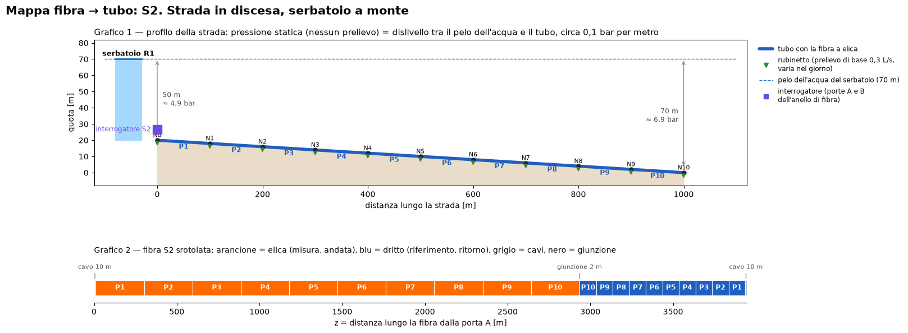
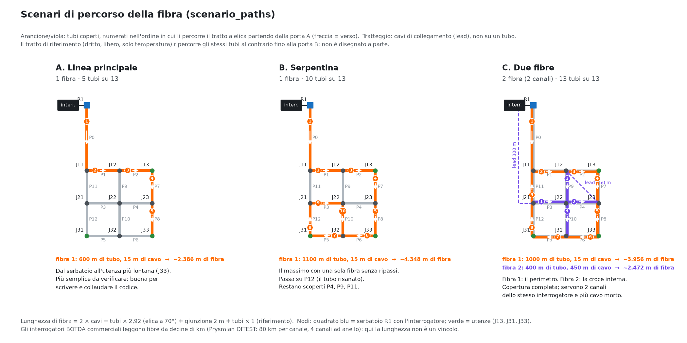
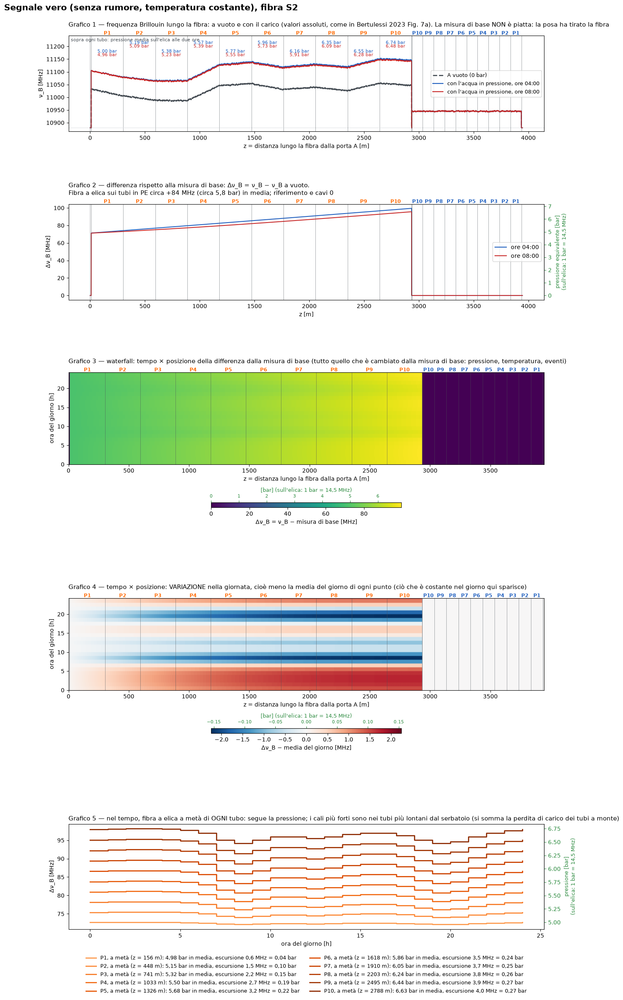
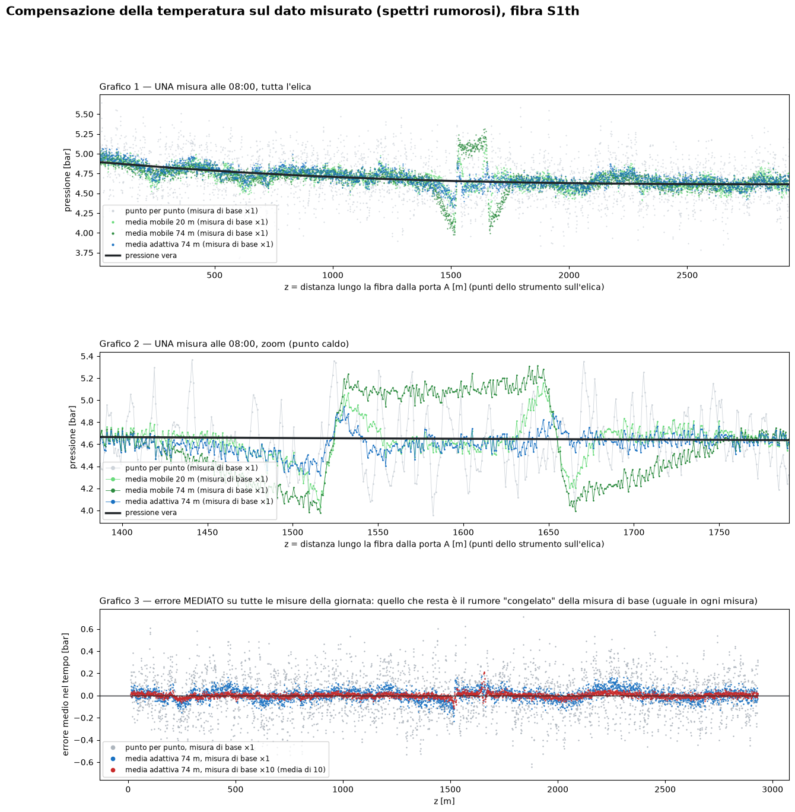
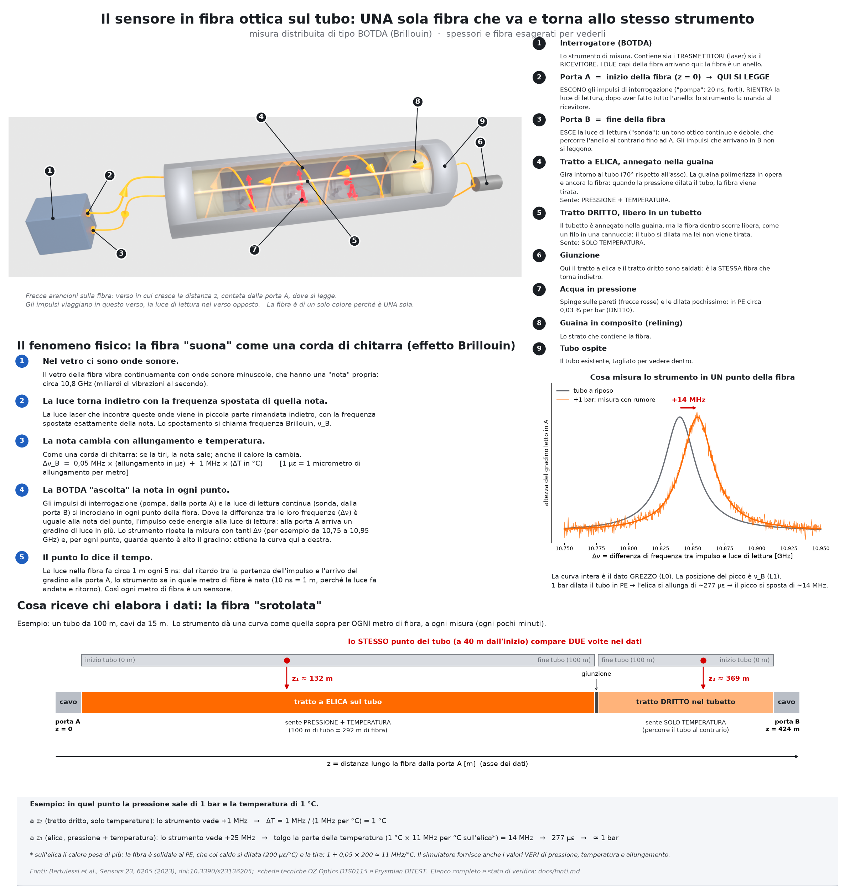

# WaterFiberSim

> **Documentazione completa: [documentazione tecnica](docs/00-indice.md)** — capitoli su fisica, modelli, parametri
> ([parametri del simulatore](docs/10-parametri-del-simulatore.md)), [validazione](docs/11-validazione.md) e
> [risultati](docs/12-risultati-e-questioni-aperte.md). Questo README resta la guida pratica (installazione, comandi).
> **Interrogatori BOTDA commerciali** (Prysmian DITEST, OZ Optics DSTS, Neubrex, Cohaerentia): [§2.5 della documentazione](docs/02-principio-di-misura.md#25-interrogatori-botda-commerciali).

Simulatore di **sensori distribuiti in fibra ottica** (DFOS) posati su una rete idrica descritta in EPANET. Prende la rete (`.inp`), sovrappone una o più fibre ai tubi, trasforma pressione e temperatura dell'acqua in una grandezza ottica lungo tutta la fibra e produce il **segnale grezzo** che leggerebbe l'interrogatore. Il DSP su quel segnale è il lavoro di chi usa il simulatore.

Le tecniche di base: **DAS** (vibrazioni, Rayleigh), **DTS** (temperatura, Raman), **DSS** (deformazione + temperatura, Brillouin). Per misurare la pressione sulle pareti del tubo servono DSS + DTS. Il documento di contesto è [docs/B-fibra-ottica-dfos.md](docs/B-fibra-ottica-dfos.md). Decisioni, ricerca e piano della sessione iniziale: [docs/C-diario-sessioni.md](docs/C-diario-sessioni.md).

## INSTALL

> **Serve Python 3.11.** L'idraulica usa [owa-epanet](https://pypi.org/project/owa-epanet/) 2.3.5, la stessa versione di `edge-slm-emulator`, che ha pacchetti precompilati solo per:
>
> | Sistema | Python |
> |---|---|
> | Linux x86_64 | 3.11, 3.12 |
> | macOS Apple Silicon | 3.11 |
> | Windows | nessuno |
>
> Con altre versioni (per esempio 3.13) pip prova a compilarlo dai sorgenti e fallisce, perché mancano SWIG e CMake. Per questo `environment.yml` fissa `python=3.11`.

```bash
conda env create -f environment.yml
conda activate waterfibersim
pip install -e .
```

## Il piano

| Passo | Cosa | Uscita | Stato |
|---|---|---|---|
| 1 | rete di prova, parametri dei tubi, percorso della fibra | mappa "metro di fibra → tubo" e disegno | ✅ fatto |
| 2 | pressione lungo la fibra (EPANET, owa-epanet) → strain → frequenza Brillouin | ν_B(z, t) vero, ancora senza ottica | ✅ fatto (scenario A) |
| 3 | segnale grezzo: spettro Brillouin con rumore, nota a riposo per metro, misura di base + un fit di esempio | L0 e un primo DSP | |
| 4 | eventi: perdita (idraulica), cedimento (meccanico) | etichette | |
| 5 | temperatura (DTS) e separazione pressione/temperatura | | |

I livelli del dato:

| Livello | Contenuto | Chi lo produce |
|---|---|---|
| **L0** | spettro Brillouin per ogni posizione e acquisizione (+ tracce Raman per il DTS), con rumore | simulatore |
| L1 | frequenza Brillouin ν_B(z, t) | DSP |
| L2 | strain ε(z, t) e temperatura T(z, t) | DSP |
| L3 | pressione stimata, eventi | DSP |

Il simulatore consegna L0 più le **etichette vere** di tutti i livelli.

---

## Passo 1 — rete, tubi, fibra

Obiettivo: descrivere **dove** sta la fibra. Niente fisica ancora: solo geometria e parametri.

### 1.1 La rete di prova

Una rete piccola, che si capisce a colpo d'occhio:

```
   R1 (serbatoio)
    │ P0  (adduttrice)
   J11 ── J12 ── J13
    │      │      │
   J21 ── J22 ── J23
    │      │      │
   J31 ── J32 ── J33
```

- **R1**: sorgente a carico fisso (serbatoio).
- **J11…J33**: griglia 3×3 di nodi, tubi da 100 m.
- **Utenze**: J13, J31, J33, 4 L/s ciascuna, con un andamento giornaliero (picchi alle 8 e alle 19).

Il file è `network/grid_3x3.inp`, in formato EPANET standard: si apre anche con EPANET o QGIS.

I file di ingresso (`.inp`, YAML) hanno **nomi e chiavi in inglese**, come l'API Python; i commenti e la documentazione restano in italiano.

### 1.1b Scenari semplici: un tubo, una strada

Per capire il segnale prima della griglia ci sono quattro scenari su una linea di 1 km (PE100 SDR11 DN110), con la stessa fibra e l'interrogatore all'inizio:

| Scenario | Rete | Cosa c'è |
|---|---|---|
| **S0a** | `network/single_pipe_flat.inp` | un solo tubo di 1 km in piano, un solo prelievo in fondo (3,3 L/s) |
| **S0b** | `network/single_pipe_downhill.inp` | lo stesso tubo in discesa (2 %), serbatoio in cima |
| **S1** | `network/street_flat.inp` | una strada in piano: 10 tubi da 100 m, un rubinetto ogni 100 m (11 da 0,3 L/s) |
| **S2** | `network/street_downhill.inp` | la stessa strada in discesa (2 %), serbatoio in cima |

La strada è un tubo solo: EPANET la spezza in 10 tratti solo perché preleva acqua nei nodi. Lo scenario con il serbatoio in fondo alla discesa non c'è: servirebbe una pompa di risalita.



### 1.2 I parametri dei tubi

L'`.inp` non si tocca: i parametri meccanici stanno in un file a parte, con valori di default e override per singolo tubo.

```yaml
# network/pipes.yaml
default:
  material: PE100
  outer_diameter_mm: 110
  wall_thickness_mm: 10
  E_GPa: 1.0          # elastic modulus
  nu: 0.40            # Poisson's ratio
  depth_m: 1.0        # burial depth (not used by the models yet)
pipes:
  P0:  {material: cast_iron, outer_diameter_mm: 222, wall_thickness_mm: 6.4, E_GPa: 170, nu: 0.26}   # supply main (no helix)
  P1:  {outer_diameter_mm: 160, wall_thickness_mm: 14.6}   # PE100 SDR11 DN160: carries the water into the grid
  P11: {outer_diameter_mm: 160, wall_thickness_mm: 14.6}
  P2:  {outer_diameter_mm: 125, wall_thickness_mm: 11.4}   # PE100 SDR11 DN125
  P12: {outer_diameter_mm: 125, wall_thickness_mm: 11.4, liner: {thickness_mm: 6, E_GPa: 8}}   # rehabilitated pipe (relining)
```

### 1.3 La fibra: un anello sull'interrogatore BOTDA

Una fibra **non si dirama**: è un percorso lineare. Con la BOTDA i due capi tornano allo stesso strumento (porta A e porta B), quindi la fibra è un **anello** con due tratti (vedi la figura del sensore più sotto e [docs/B-fibra-ottica-dfos.md §2.1](docs/02-principio-di-misura.md#22-il-principio-botda-panoramica)):

- **tratto di misura** (*sensing leg*): dalla porta A, a **elica solidale** al tubo; nella guaina di risanamento è **annegata**, che polimerizza in opera e la ancora; sente pressione + temperatura;
- **tratto di riferimento** (*reference leg*): ritorna alla porta B ripercorrendo **gli stessi tubi** al contrario, **dritto e libero in un tubicino**; sente solo la temperatura.

Nel file si scrive solo il percorso di andata. Il ritorno è sempre lo stesso percorso al contrario, perché il riferimento deve misurare la temperatura negli stessi punti.

Le fibre si descrivono in uno **scenario di percorso**: un file YAML in [scenario_paths/](scenario_paths/) con la lista delle fibre (una o più, ciascuna su un canale dell'interrogatore). Esempio, lo scenario A:

```yaml
# scenario_paths/A_main_line.yaml
title: "A. Linea principale"
network: network/grid_3x3.inp
pipes: network/pipes.yaml
fibers:
  - id: A1
    interrogator:                # loop: both fiber ends on the instrument (ports A and B)
      node: R1
      technique: BOTDA
      channel: 1
      pulse_width_ns: 20         # pump pulse duration -> spatial resolution c*tau/(2n) ~ 2 m       [\[B23\]](docs/A-fonti.md#b23)
      adc_sample_rate_msps: 125  # ADC sampling rate   -> sampling interval c/(2n f_s) ~ 0.8 m     [\[B23\]](docs/A-fonti.md#b23)
      freq_step_mhz: 1           # frequency scan step (delta)                                     [\[B23\]](docs/A-fonti.md#b23) Tab. 1, phase II
      n_averages: 256            # traces averaged per frequency step (N_AV)                       [\[B23\]](docs/A-fonti.md#b23) Tab. 1
      scan_window_ghz: [10.75, 11.3]  # must contain every peak (rest profile + pressure + temperature)  [\[B23\]](docs/A-fonti.md#b23) Tab. 1, phase II
      linewidth_mhz: 58          # Brillouin gain FWHM with a 2 m resolution                       [\[ST13\]](docs/A-fonti.md#st13) §3
      snr0_db: 0                 # SNR at the fibre input, one trace, at snr0_resolution_m ("realistic")  [\[ST13\]](docs/A-fonti.md#st13) §3
      snr0_resolution_m: 2
    group_index: 1.468         # fibre group index (v = c/n): TO VERIFY on a datasheet
    attenuation_db_per_km: 0.2 # fibre loss at 1550 nm (measured 0.211-0.22 dB/km)                       [\[ST13\]](docs/A-fonti.md#st13) §2-3
    calc_step_m: 0.1           # simulator calculation step along the fibre (NOT the instrument sampling)
    sensing_leg:   {layout: helix, angle_deg: 70, bonding: bonded}   # embedded | bonded
    reference_leg: {layout: straight, bonding: loose_tube}
    route:                     # ordered from port A; the reference leg retraces it backwards to port B
      - {lead: 215, to: J11}   # lead-in cable along P0: no helix on the cast-iron main
      - {pipe: P1, from: J11}
      - {pipe: P2, from: J12}
      - {pipe: P7, from: J13}
      - {pipe: P8, from: J23}
    junction_m: 2              # splice at the far end: sensing leg -> reference leg
```

**I parametri dello strumento sono nel tempo**, come nell'interrogatore vero: la durata dell'impulso (ns) e la frequenza dell'ADC (milioni di campioni al secondo). I metri si **ricavano**, perché la luce va e torna e il punto z arriva al fotodiodo dopo t = 2z/v, con v = c/n:

```
passo di campionamento   Δz = c / (2 · n · f_ADC)   125 MS/s (un campione ogni 8 ns) → 0,82 m
risoluzione spaziale     Δz = c · τ / (2 · n)       impulso di 20 ns                  → 2,04 m
```

Il comando `map` li stampa. `calc_step_m` è un'altra cosa: il passo a cui il simulatore calcola il segnale vero, scelto fine (0,1 m, al massimo 1/10 della risoluzione) per poter poi simulare la media su 2 m. **Oggi il simulatore calcola solo il segnale vero**: la media e il campionamento dello strumento arrivano al passo 3.

Gli scenari si conservano tutti e servono per esperimenti diversi:



| Scenario | Fibre | Tubi coperti | Uso |
|---|---|---|---|
| [A_main_line](scenario_paths/A_main_line.yaml) | 1 | 4 su 13 | collaudare il codice: si verifica a mano |
| [B_serpentine](scenario_paths/B_serpentine.yaml) | 1 | 9 su 13 | il massimo con una fibra; passa sul tubo risanato P12 |
| [C_two_fibers](scenario_paths/C_two_fibers.yaml) | 2 (2 canali) | 12 su 13 | tutta la griglia, più fibre e cavi di collegamento |

La figura si rigenera dai YAML con `python docs/img/scenario_paths.py`, che scrive anche [scenario_paths.drawio.svg](docs/img/scenario_paths.drawio.svg), modificabile in draw.io.

- `lead` è un cavo che collega senza stare su un tubo (prima si chiamava "tratto morto"); `to`/`from` dicono quali nodi collega. Viene percorso due volte, all'andata e al ritorno.
- Una fibra non può passare due volte sullo stesso tubo. Se la rete non si copre con un solo percorso, si usano più fibre nello stesso scenario, su più canali dello stesso interrogatore (scenario C).

### 1.4 La mappa "metro di fibra → tubo"

È il prodotto del passo 1 e servirà a tutti i passi successivi. Per ogni campione lungo la fibra, con z contato dalla porta A (dove si legge):

| z_m | leg | pipe | s_pipe_m | x, y |
|---|---|---|---|---|
| 0.0 | lead | — | — | … |
| 15.0 | sensing | P0 | 0.00 | … |
| 15.5 | sensing | P0 | 0.17 | … |
| … | junction | — | — | … |
| … | reference | P0 | 199.5 | … |

**Ogni punto di un tubo compare due volte**: sul tratto di misura e sul tratto di riferimento. È così che si separano pressione e temperatura.

Sull'elica **un metro di fibra copre meno di un metro di tubo**: s_pipe avanza di `passo · cos α` per ogni passo di fibra. Con α = 70° servono circa 2,9 m di fibra per ogni metro di tubo. Sul tratto di riferimento, dritto, s_pipe avanza di un passo intero, all'indietro.

### 1.5 Come si verifica il passo 1

- Disegno della rete con la fibra sopra, colorata per distanza dall'interrogatore.
- La lunghezza totale della fibra torna con: 2 × cavi `lead` + tubi × 1/cos α (elica) + giunzione + tubi × 1 (riferimento).
- Ogni tubo coperto compare nella mappa due volte (misura e riferimento), con s_pipe che va da 0 alla sua lunghezza.

```bash
python -m waterfibersim map scenario_paths/A_main_line.yaml --out out/A    # out/A/fiber_map.csv + fiber_map.png
pytest                                                                     # tests/test_fibermap.py
```

Scenario A: 2001,5 m di fibra (2 × 215 m di cavo + 400 m di tubo × 2,92 + 2 m di giunzione + 400 m di riferimento), 20 016 punti di calcolo ogni 0,1 m.


---

## Passo 2 — segnale vero lungo la fibra

```bash
python -m waterfibersim run scenario_paths/A_main_line.yaml --out out/A --hours 24 --step-min 15
```

**La rete di prova è dimensionata con criteri di progetto** (vedi `docs/A-fonti.md`): al picco dei consumi la velocità nei tubi principali è di 0,5–0,9 m/s e la perdita di carico non supera 10 m/km in nessun tubo. Per questo P1 e P11, che portano l'acqua nella griglia, sono DN160; P2 e P12 (risanato) DN125; gli altri DN110 (PE100 SDR11). Le utenze J13, J31, J33 consumano 4 L/s ciascuna. Con una rete così, **la pressione nella giornata varia di circa 0,2 bar**: in una rete ben progettata le perdite di carico sono tenute basse apposta. Variazioni più grandi, nella realtà, vengono da dislivelli, pompe, valvole e distanze lunghe.

Con `--demand-multiplier` si moltiplicano tutti i consumi (opzione EPANET *Demand Multiplier*), solo per esperimenti di sensibilità: con ×3 la rete esce dai criteri di progetto (perdite di carico ben oltre 10 m/km).

La catena, un modulo per anello:

```
hydraulics.py   EPANET (owa-epanet): pressione nei nodi, una misura ogni 15 minuti
simulate.py     pressione lungo il tubo, lineare tra i due nodi
mechanics.py    deformazione della parete, Lamé sulla superficie esterna      [Bertulessi 2023, Eq. 4–6]
                deformazione della fibra a elica: ε_θ·sin²α + ε_z·cos²α; riferimento libero = 0
brillouin.py    ν_B = ν_B0 + C_ε·ε + C_T·ΔT, con C_ε = 0,05 MHz/µε, C_T = 1 MHz/°C   [Bertulessi 2023, Eq. 1]
```

In `out/A/`:
- `signal_true.npz`: matrici **tempo × posizione** (97 × 20 016 per lo scenario A) di `nu_b_mhz`, `strain_ue`, `pressure_bar`, più `z_m`, `leg`, `pipe` di ogni colonna e `times_s`;
- `signal_true_<fibra>.png`: la figura qui sotto.


Cosa si vede, nello scenario A:
- Sulla **fibra a elica dei tubi in PE (plastica)** la frequenza sta circa 70 MHz sopra il tubo vuoto (circa 4,8 bar) e varia di 2–3 MHz nella giornata, seguendo i consumi: circa 14,5 MHz per bar su tutti i tubi in PE: con tubi SDR11 lo spessore è proporzionale al diametro, quindi la sensibilità non dipende dal diametro.
- Sul **tratto di riferimento** e su cavi e giunzione resta a 0.
- **P0, l'adduttrice in ghisa, non ha l'elica**: la fibra ci passa solo come cavo. Su un tubo così rigido la fibra a elica sentirebbe circa 0,2 MHz per bar, sotto un errore indicativo dello strumento (circa 0,5 MHz, vedi sotto): non avrebbe senso. È lo stesso problema di una guaina appoggiata a un tubo ospite rigido.
- La variazione nella giornata (circa ±0,9 MHz) è **al limite** di un errore indicativo di ±0,5 MHz per una singola misura in un singolo punto: per vederla bene servirà la media nello spazio e nel tempo.

### Gli scenari semplici: cosa insegnano

```bash
python -m waterfibersim run scenario_paths/S2_street_downhill.yaml --out out/S2
```

| | inizio, 03:00 → 08:00 | fine, 03:00 → 08:00 | escursione nel giorno (max) |
|---|---|---|---|
| S0a tubo, piano | 4,90 → 4,89 bar | 4,85 → 4,06 bar | 0,8 bar in fondo |
| S0b tubo, discesa | 4,90 → 4,89 bar | 6,81 → 6,02 bar | 0,8 bar in fondo |
| S1 strada, piano | 4,90 → 4,89 bar | 4,89 → 4,61 bar | 0,3 bar in fondo |
| S2 strada, discesa | 4,90 → 4,89 bar | 6,85 → 6,58 bar | 0,3 bar in fondo |

- **La quota dà una pendenza fissa**: lungo una discesa la pressione cresce di circa 1 bar ogni 10 m, anche allontanandosi dal serbatoio, perché sopra il punto c'è più colonna d'acqua. Non cambia nel tempo.
- **La perdita di carico dà la variazione nel tempo**: cresce nelle ore di punta ed è più forte lontano dal serbatoio, nel verso del flusso.
- **Tubo singolo contro strada**, con la stessa acqua prelevata: nel tubo singolo tutta la portata percorre tutto il tubo, quindi la pressione cala in linea retta e di più (0,8 contro 0,3 bar); nella strada la portata diminuisce a ogni rubinetto.



## Passo 3a — incertezza attesa dello strumento

```bash
python -m waterfibersim instrument scenario_paths/S1_street_flat.yaml --out out/S1
```

Dali parametri dell'interrogatore nello scenario calcola, senza ancora simulare il rumore, quanto sbaglierà lo strumento. Modello di Soto & Thévenaz 2013 (`docs/A-fonti.md`, [\[ST13\]](docs/A-fonti.md#st13)):

```
incertezza sul picco   σ_ν = (1/SNR) · √( 3·δ·Δν_B / (8√2·(1−η)^{3/2}) )      [\[ST13\]](docs/A-fonti.md#st13) Eq. 7  (η = 0,5: √(¾·δ·Δν_B)/SNR)
SNR lungo la fibra     SNR(z) = SNR₀ · (Δz/Δz₀) · √N_AV · e^(−αz)              [\[ST13\]](docs/A-fonti.md#st13) Eq. 9
tempo minimo           passi di frequenza × N_AV × (andata e ritorno sull'anello, 2·L·n/c)
```

δ = passo di frequenza, Δν_B = larghezza della campana, N_AV = medie, Δz = risoluzione, α = attenuazione, SNR₀ = 0 dB a 2 m e una traccia (valore "realistico" di [\[ST13\]](docs/A-fonti.md#st13)).

Con le impostazioni di Bertulessi 2023 (20 ns, 1 MHz, 256 medie):

| | S1 (anello 3,9 km) | A (anello 2,0 km) |
|---|---|---|
| incertezza di una misura sull'elica | 0,40–0,46 MHz = 0,028–0,032 bar | 0,41–0,43 MHz = 0,028–0,030 bar |
| dopo la sottrazione della misura di base (×√2) | fino a 0,65 MHz = 0,045 bar | fino a 0,61 MHz = 0,042 bar |
| riferimento | 0,46–0,48 °C | 0,43–0,44 °C |
| tempo minimo di una misura | 5,5 s (senza i tempi morti dello strumento) | 2,8 s |

- In fondo alla strada S1 l'escursione giornaliera (0,27 bar) è circa 6 volte l'incertezza; vicino al serbatoio (0,04 bar) è pari all'incertezza: con una misura sola non si vede.
- Sulle nostre lunghezze (2–4 km) la distanza pesa poco: +15 % di incertezza.
- Il comando controlla anche che tutti i picchi cadano nella finestra di scansione (margine oggi circa 120 MHz: circa 10 °C sull'elica).
- **Da affrontare:** la compensazione della temperatura. L'errore del riferimento (circa 0,47 °C per misura) pesa sull'elica 3,5–8 MHz/°C (6 negli scenari): circa 2,8 MHz ≈ 0,2 bar per misura, se il riferimento non viene mediato su molti metri (cap. 7).


## Passo 3b — dato grezzo L0: spettri con rumore

```bash
python -m waterfibersim measure scenario_paths/S1_street_flat.yaml --out out/S1 [--every-min 60]
```

Produce quello che darebbe lo strumento: per ogni misura (di default una all'ora) e ogni punto dello strumento (ogni 0,82 m), lo **spettro Brillouin intero** sulla finestra di scansione (551 frequenze a 1 MHz), con il rumore. Più la misura di base (anch'essa rumorosa), le etichette vere e un **fit di esempio**.

```
punti dello strumento   ogni c/(2·n·f_ADC) ≈ 0,82 m
ogni punto              media degli spettri locali su c·τ/(2n) ≈ 2 m (finestra centrata)        [\[B23\]](docs/A-fonti.md#b23)
spettro locale          lorentziana, FWHM 58 MHz, picco normalizzato a 1                        [\[ST13\]](docs/A-fonti.md#st13) Fig. 5
rumore                  gaussiano, indipendente per frequenza, σ = 1/SNR(z) (SNR dal passo 3a)  [\[ST13\]](docs/A-fonti.md#st13)
fit di esempio          parabola sui punti entro ±FWHM/2 dalla stima del picco, ricentrata       [\[ST13\]](docs/A-fonti.md#st13)
```

File in `out/S1/`: `raw_L0_S1.npz` (L0: 25 × 4831 × 551, circa 130 MB, con etichette), `fit_L1_S1.npz` (picchi stimati), `raw_S1.png`.

| tratto | errore del fit misurato | previsto da Soto & Thévenaz (Eq. 7) |
|---|---|---|
| elica | 0,50 MHz (≈ 0,035 bar) | 0,43 MHz |
| riferimento | 0,56 MHz | 0,47 MHz |

- Il fit di esempio fa circa il 17 % peggio della formula (verificato anche su spettri sintetici): la formula assume una parabola, la campana è lorentziana; [\[ST13\]](docs/A-fonti.md#st13) avverte che il fattore numerico dipende dalla forma.
- Dove la finestra di 2 m prende tratti diversi (per esempio elica e riferimento alla giunzione) lo spettro ha più picchi e il fit sbaglia anche di 100 MHz: è un effetto reale della risoluzione, da gestire nell'elaborazione.


## Temperatura del terreno e compensazione (passi T2 e T3)

**T2 — la temperatura nel segnale.** Uno scenario può avere una sezione `temperature` (facoltativa): terreno alla misura di base e oggi, deriva stagionale, sensibilità dell'elica alla temperatura, variazioni locali (`hotspots`, con `delta_c` positivo o negativo). Il riferimento sente 1 MHz/°C; l'elica sente anche la dilatazione del tubo: **3,5–8 MHz/°C** secondo le fonti (⚠️ da calibrare), contro 14,5 MHz/bar per la pressione. Quindi **1 °C si legge come 0,24–0,55 bar**. Scenari di prova: **S1t** (strada S1, terreno 8 °C più freddo che alla misura di base, uniforme) e **S1th** (in più un punto caldo di +3 °C su P6, scelto per mostrare l'effetto).

```yaml
temperature:
  baseline_c: 18             # terreno alla misura di base
  soil_c: 10                 # terreno oggi
  drift_c_per_day: -0.15     # raffreddamento stagionale            [Stewart & Bilgin 2020]
  helix_mhz_per_c: 6         # forbice 3,5–8: DA CALIBRARE
  hotspots:                  # solo in S1th                          [Agudelo-Vera et al. 2017]
    - {pipe: P6, from_m: 20, to_m: 60, delta_c: 3}
```

**T3 — la compensazione.** `python -m waterfibersim compensate scenario_paths/S1th_street_flat_soil_hotspot.yaml --out out/S1th`: per ogni punto dell'elica si prende il riferimento sullo stesso tubo nello stesso punto, ΔT = Δν_rif / 1 MHz/°C, si toglie K·ΔT dall'elica e si converte in bar.

| alle 08:00, S1th (pressione vera circa 4,7 bar) | errore |
|---|---|
| senza compensare | −3,3 bar |
| compensata, K giusto | circa 0 |
| compensata con K = 3,5 o 8 invece di 6 | −1,4 / +1,1 bar (**sistematico**: non cala con le medie) |
| K giusto, riferimento punto per punto (interpolato nel punto del tubo) | 0,001 bar |
| K giusto, media mobile del riferimento su 20 m / 74 m | fino a 0,47 / 0,58 bar ai bordi del punto caldo |
| K giusto, media **adattiva** su 74 m (solo i vicini con temperatura entro 0,5 °C) | fino a 0,19 bar, solo nelle rampe ai bordi |
| errore casuale di una misura, riferimento punto per punto / mediato su 74 m | 0,24 / 0,056 bar |

- Il limite principale è **K**: va calibrato sul posto.
- Il rumore del riferimento si riduce mediandolo, ma la media mobile sfuma le variazioni locali di temperatura. La media adattiva si ferma da sola ai bordi; la sua soglia (0,5 °C, ⚠️ scelta) è dell'ordine del rumore del riferimento e andrà verificata con il rumore vero (passo 3b): oggi tutto è senza rumore.
- Senza compensare, solo le variazioni **nella giornata** restano leggibili (il terreno cambia di circa 0,15 °C al giorno); il valore assoluto no.


### Compensazione sul dato misurato (spettri rumorosi)

`python -m waterfibersim compensate scenario_paths/S1th_street_flat_soil_hotspot.yaml --measured --out out/S1th [--baseline-repeats N]`: stessa compensazione, ma sui picchi stimati dagli spettri rumorosi del passo 3b (picco − picco della misura di base). I punti la cui finestra di 2 m mescola tratti diversi sono esclusi.

| errore sulla pressione [bar], 25 misure, K giusto | casuale, per misura | congelato (base ×1) | congelato (base ×10) | vicino al punto caldo (S1th) |
|---|---|---|---|---|
| punto per punto | 0,185 | 0,193 | 0,073 | rumoroso |
| media mobile 74 m | 0,042 | 0,043 | 0,016 | fino a 0,65 |
| media adattiva 74 m | 0,050 | 0,049 | 0,018 | fino a 0,22 |

- Il modello del passo T3 è confermato: con la media mobile su 74 m l'errore di una misura è circa 0,06 bar.
- La media adattiva regge il rumore se il confronto si fa con una **mediana su 10 m** e la soglia è **2 volte il rumore del riferimento stimato dai dati** (⚠️ scelte); con una soglia fissa di 0,5 °C non media quasi nulla.
- **Il rumore della misura di base è "congelato"**: uguale in tutte le misure successive, non si riduce mediando nel tempo. Rimedio: misura di base come media di più misure (con 10, circa 3 volte meno).



### Temperatura dell'acqua (scenario S1w)

L'acqua esce dal serbatoio a una temperatura diversa dal terreno e lungo i tubi vi si avvicina (Blokker et al. 2024, *Water* 16, 2796, Eq. 1–3): T = T_terreno + (T_ingresso − T_terreno)·e^(−k·τ), con k da diametro, PE (0,38 W/m·K), terreno e velocità, ora per ora; nei nodi le acque si mescolano. Di giorno l'acqua arriva veloce e calda in fondo alla strada, di notte si porta al terreno: la temperatura cambia **con il ritmo dei consumi**.

S1w (acqua +2 °C sul terreno): in fondo alla strada la pressione vera scende di 0,27 bar al picco, quella letta senza compensare **sale** di 0,09 bar (segno invertito). Con il riferimento (libero nel tubicino, stessa temperatura dell'elica) l'errore torna quello del rumore (circa 0,06 bar per misura).

Posa decisa: elica annegata nella guaina, ritorno annegato nella stessa guaina ma libero in un tubicino. I cavi di collegamento (`lead`) stanno nel terreno e misurano la temperatura del terreno.

### Cosa il simulatore non fa ancora

Il **profilo a riposo** c'è già: ogni metro ha la sua frequenza a tubo vuoto (elica da +105 a +180 MHz, tratto libero +65 MHz, come in Bertulessi 2023 Fig. 7a; forma casuale, `--seed`: continua lungo un'elica avvolta senza interruzioni, con un salto solo dove la posa riparte, cioè dopo un cavo o dove cambia il tubo; ipotesi, vedi `docs/A-fonti.md`), e la misura di base lo cancella. Per il resto il segnale è **ideale**: la frequenza segue la pressione in modo esatto e proporzionale. È la **verità** (le etichette). Quello che riceverà chi elabora i dati (L0) sarà questa verità con i disturbi reali, aggiunti uno alla volta:

| Cosa manca | Effetto sul segnale | Quando | Fonte |
|---|---|---|---|
| rumore dello strumento | ogni misura sbaglia; ±0,5 MHz è solo **indicativo** (da 0,1 a 2 MHz secondo strumento, lunghezza e tempo di media) | incertezza attesa (passo 3a) e rumore sullo spettro (passo 3b): **fatti** | Bertulessi 2023: *"better than 0.5 °C/10 µε"*; schede OZ Optics e Prysmian DITEST (vedi `docs/A-fonti.md`) |
| spettro invece del valore | si riceve la curva intera, il picco va trovato | **fatto** (passo 3b) | Bertulessi 2023 §2.1, Fig. 7b; Soto & Thévenaz 2013 |
| risoluzione spaziale | lo strumento media su circa 2 m: i passaggi tra tubi si sfumano | **fatto** (passo 3b) | Bertulessi 2023: 20 ns, *"equivalent to a 2 m spatial resolution"* |
| temperatura dell'acqua | l'acqua che scorre può portare la temperatura del serbatoio, insieme ai consumi | dopo il terreno (T2/T3 fatti) | Agudelo-Vera et al. 2017; Stewart & Bilgin 2020 |
| creep del PE | la deformazione arriva in ritardo e continua a crescere | più avanti | Bertulessi 2023, modello di Burgers, Fig. 8 |
| trasferimento alla fibra < 100 % | la fibra sente solo una parte della deformazione | da decidere | ⚠️ oggi ipotesi: 100 % |
| calibrazione del rapporto MHz → bar | nella realtà il rapporto (coefficienti della fibra, rigidezza del tubo, trasferimento) va calibrato; il simulatore oggi lo conosce esatto | da decidere | Bertulessi 2023 Eq. 1: i coefficienti *"are highly influenced by the cable coating properties and the bonding conditions"* |
| guaina + tubo ospite | il rapporto MHz/bar dipende dal laminato e dal tubo dietro; i tubi risanati danno errore | quando arriverà il laminato (dati del laminato reale) | modello a più strati da fare |

Altre semplificazioni: pressione a scalini di un'ora (gli andamenti di consumo nell'`.inp` sono orari), tubi dritti tra i due nodi.

---

## Come si avvolge la fibra

**Sì, l'elica è la scelta corretta** quando si vuole misurare la pressione. Le possibilità principali:

| Posa | Cosa sente | Uso |
|---|---|---|
| **dritta lungo l'asse** (α = 0°) | deformazione assiale | flessione, cedimenti del terreno; con fibra libera, la temperatura |
| **ad anelli** (α ≈ 90°) | deformazione circonferenziale pura | massima sensibilità alla pressione, ma servono raccordi tra un anello e l'altro |
| **a elica** (0° < α < 90°) | una miscela delle due | **il compromesso usato in pratica** |

La deformazione che sente la fibra a elica:

**ε_fibra = ε_θ · sin²α + ε_z · cos²α**

dove ε_θ è la deformazione circonferenziale (quella grande, dovuta alla pressione) e ε_z quella assiale. Più α si avvicina a 90°, più la fibra "vede" la pressione.

Il prezzo è la lunghezza: un metro di tubo richiede **1 / cos α** metri di fibra.

| α | sensibilità alla pressione (sin²α) | fibra per metro di tubo | 1 m di risoluzione della fibra corrisponde a |
|---|---|---|---|
| 45° | 50 % | 1,4 m | 71 cm di tubo |
| 60° | 75 % | 2,0 m | 50 cm di tubo |
| 70° | 88 % | 2,9 m | 34 cm di tubo |
| 80° | 97 % | 5,8 m | 17 cm di tubo |

Più fibra per metro significa risoluzione migliore sul tubo, ma anche più attenuazione e meno metri di rete coperti dallo stesso interrogatore.

Altri due vincoli:
- **Curvatura:** l'elica ha raggio di curvatura R / sin²α, quindi non scende mai sotto il raggio del tubo. Per un DN110 (R = 55 mm) va bene anche una fibra standard; le fibre "insensibili alla curvatura" (ITU-T G.657) reggono fino a 7,5–10 mm.
- **Fibra di riferimento:** di solito accanto all'elica si posa una **fibra dritta in tubicino libero**, che non sente lo strain e misura solo la temperatura. Serve a compensare (vedi passo 5).

Nella guaina di risanamento la fibra si annega nel composito della guaina durante la produzione. Se la guaina è fatta per avvolgimento di filamenti, l'elica viene naturale.

---

## Modello 3D e figura del sensore



La figura spiega il sistema a chi non conosce la fibra: **una sola fibra ad anello**, i cui due capi arrivano allo **stesso interrogatore** (BOTDA).

- **Porta A** (z = 0): esce l'impulso laser ed entra la luce che lo strumento legge.
- **Andata a elica**, annegata nella guaina e ancorata dalla polimerizzazione: sente pressione + temperatura.
- **Giunzione** in fondo al tratto.
- **Ritorno dritto** in un tubicino libero: sente solo temperatura.
- **Porta B**: entra il laser continuo, che percorre l'anello al contrario.

La figura spiega anche l'effetto Brillouin e la fibra "srotolata", in cui ogni punto del tubo compare due volte (z₁ sull'elica, z₂ sul ritorno). Per differenza tra i due punti si separano temperatura e pressione.

Si genera in due passi:

| Script | Cosa fa | Serve |
|---|---|---|
| [blender/tubo_fibra.py](blender/tubo_fibra.py) | spaccato 3D → `tubo_fibra_3d.png` + `tubo_fibra_3d.json` (posizione in pixel dei punti notevoli) e, a richiesta, il `.blend` | Blender (o il modulo `bpy`) |
| [blender/schema_sensore.py](blender/schema_sensore.py) | render + didascalie + grafici → `tubo_fibra.png` | solo matplotlib |

```bash
# apre Blender con la scena pronta (le etichette 3D sono visibili nella vista, non nel render)
blender --python blender/tubo_fibra.py

# render senza interfaccia + file .blend, poi la figura finale
blender -b --python blender/tubo_fibra.py -- --render blender/tubo_fibra_3d.png --save blender/tubo_fibra.blend
python blender/schema_sensore.py
```

- Il `.blend` va generato con la **stessa versione di Blender** con cui lo si apre: un file salvato con Blender 5.0 non si apre con la 4.2. Per questo non è in git.
- Spessori e fibra sono **esagerati** per renderli visibili.
- I numeri dei grafici (PE DN110, elica a 70°, coefficienti Brillouin) sono **indicativi**.
- I parametri della scena (angolo `ALFA_DEG`, raggi, lunghezza) sono in cima a `tubo_fibra.py`.
