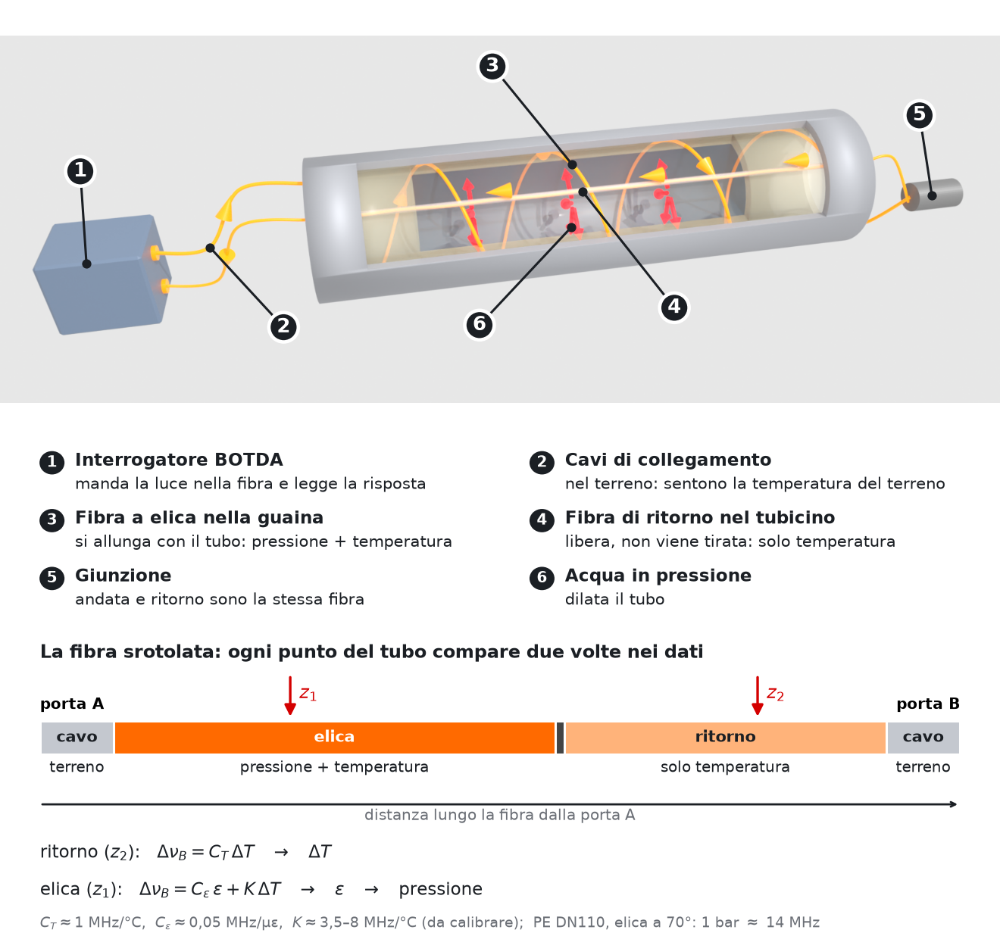
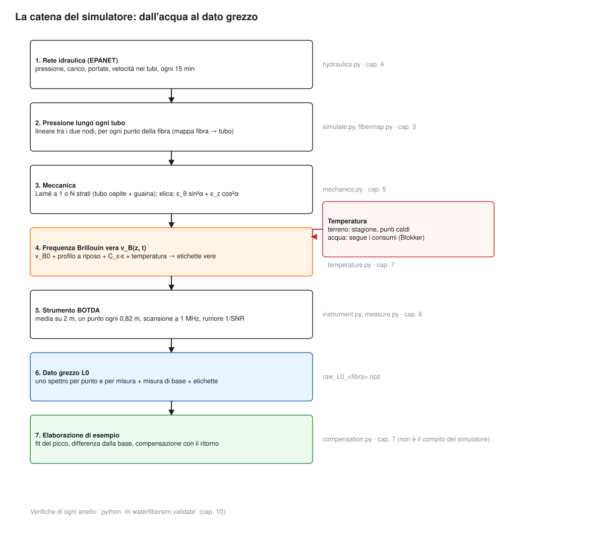

# WaterFiberSim

Simulatore di una misura in fibra ottica della **pressione dell'acqua sulle pareti dei tubi** di una rete idrica
descritta in EPANET. Una fibra è annegata a elica nella guaina di risanamento del tubo ed è letta da uno strumento
Brillouin (BOTDA). Il simulatore produce:

- il **dato grezzo L0** che darebbe lo strumento: spettri Brillouin con il rumore, punto per punto lungo la fibra;
- le **etichette vere**: pressione, deformazione, temperatura e frequenza Brillouin in ogni punto e in ogni istante.

L'elaborazione dei dati (da L0 alla pressione stimata) è il lavoro di chi usa il simulatore.

**Documentazione: [indice](docs/00-indice.md).** Per usare il simulatore basta la
[guida all'uso (cap. 8)](docs/08-guida-all-uso.md). Cosa è dimostrato e quali sono i limiti:
[validazione (cap. 11)](docs/11-validazione.md) e [risultati e questioni aperte (cap. 12)](docs/12-risultati-e-questioni-aperte.md).

## Il sistema



Una sola fibra ottica parte dall'interrogatore, percorre il tubo e torna indietro allo stesso strumento.
- **Andata**: la fibra è annegata **a elica** nella guaina di risanamento. Quando la pressione dell'acqua dilata il
  tubo, la fibra si allunga: sente pressione e temperatura.
- **Ritorno**: la fibra è **libera in un tubicino** nella stessa guaina. Non viene tirata: sente solo la temperatura.

Lo strumento misura, metro per metro, la frequenza Brillouin $\nu_B$ della fibra, che si sposta con l'allungamento e
con la temperatura. Ogni punto del tubo compare due volte nei dati: sul ritorno si ricava la temperatura, che poi si
toglie dall'elica, e resta la pressione ([cap. 2](docs/02-principio-di-misura.md),
[cap. 3](docs/03-il-sensore-sul-tubo.md)).

## Cosa fa il simulatore



1. **Rete idraulica**: legge la rete EPANET (`.inp`) e calcola la pressione nei tubi nell'arco della giornata
   (owa-epanet).
2. **Posa della fibra**: associa ogni metro di fibra a un punto di un tubo (andata, ritorno, cavi di collegamento).
3. **Meccanica**: trasforma la pressione in deformazione della fibra con un modello a strati (tubo ospite, guaina,
   fibra) ([cap. 5](docs/05-meccanica-del-tubo.md)).
4. **Temperatura**: terreno con deriva stagionale e variazioni locali, acqua che si porta verso la temperatura del
   terreno ([cap. 7](docs/07-temperatura-e-compensazione.md)).
5. **Strumento**: genera gli spettri Brillouin con il rumore di uno strumento reale, con risoluzione, campionamento,
   medie e attenuazione impostabili ([cap. 6](docs/06-strumento-e-dato-grezzo.md)).
6. **Esempi di elaborazione**: un fit del picco e una compensazione della temperatura, per verificare che dal dato
   grezzo si torni alla pressione.

Le uscite sono file NumPy (`.npz`) e CSV con il dato grezzo e tutte le etichette vere, più le figure
([§8.5](docs/08-guida-all-uso.md#85-i-file-di-uscita)).

## Risultati raggiunti

Ogni modello è confrontato con un dato indipendente ([cap. 11](docs/11-validazione.md)):

| verifica | simulatore | riferimento |
|---|---|---|
| perdita di carico in un tubo PE DN110 da 1 km | 8,504 m | 8,504 m (formula di EPANET) |
| spostamento Brillouin sull'elica, tubo PE a 5 bar | 69 MHz (con il rilassamento viscoelastico del PE) | 73 MHz misurati (Bertulessi et al. 2023) |
| incertezza sul picco con le impostazioni di laboratorio | 0,40 MHz | migliore di 0,5 MHz (Bertulessi et al. 2023) |
| incertezza sul picco, modello dello strumento | 0,76 MHz | 0,75 MHz misurati (Soto e Thévenaz 2013) |
| errore di una misura compensata in temperatura | 0,059 bar | 0,055 bar (propagazione degli errori) |

Cosa ne risulta ([cap. 12](docs/12-risultati-e-questioni-aperte.md)):
- **su tubo in PE la pressione si misura**: circa 13–14 MHz/bar contro 0,4–0,5 MHz di rumore, cioè circa 0,03 bar per
  misura (0,06 bar dopo la compensazione della temperatura); le variazioni giornaliere di una rete (0,1–0,3 bar) sono visibili;
- **la temperatura si toglie** con il ritorno libero nella stessa guaina, se la sensibilità termica dell'elica è
  calibrata;
- **limiti noti**: una guaina dentro un tubo rigido integro (ghisa) sente circa 0,4–0,5 MHz/bar, troppo poco; a 10 bar il
  PE si deforma 1,4 volte più del modello (scorrimento viscoso); i dati del laminato della guaina reale non sono ancora
  disponibili.

## Potenzialità e integrazioni

- **Sviluppo dell'elaborazione dei dati con la verità nota**: chi sviluppa algoritmi (stima del picco, compensazione,
  rilevamento di anomalie) può misurarne l'errore rispetto alle etichette vere, senza installazioni in campo.
- **Dimensionamento prima della posa**: quale tubo, quale angolo dell'elica, quale strumento e quanto tempo di misura
  servono per vedere una data variazione di pressione ([cap. 10](docs/10-parametri-del-simulatore.md)).
- **Gemello digitale della rete**: l'ingresso è un normale file EPANET e l'uscita è la pressione lungo i tubi, vera e
  ricostruibile dal dato in fibra, nel tempo. Il simulatore è pensato per essere collegato a un gemello digitale EPANET e a un
  emulatore di rete di sensori; oggi i due progetti sono indipendenti e l'integrazione è un passo successivo.

## Installazione

Serve **Python 3.11**: l'idraulica usa [owa-epanet](https://pypi.org/project/owa-epanet/) 2.3.5, che ha pacchetti
precompilati solo per Linux x86_64 (Python 3.11 e 3.12) e macOS Apple Silicon (Python 3.11); per Windows nessuno.

```bash
conda env create -f environment.yml
conda activate waterfibersim
pip install -e .
pytest -q
```

## Esempio

```bash
python -m waterfibersim map        scenario_paths/S1_street_flat.yaml --out out/S1   # metro di fibra -> tubo
python -m waterfibersim run        scenario_paths/S1_street_flat.yaml --out out/S1   # segnale vero nel tempo
python -m waterfibersim instrument scenario_paths/S1_street_flat.yaml --out out/S1   # incertezza dello strumento
python -m waterfibersim measure    scenario_paths/S1_street_flat.yaml --out out/S1   # dato grezzo L0
```

Tutti i comandi, i file di ingresso e di uscita e la lettura dei risultati in Python sono nel
[cap. 8](docs/08-guida-all-uso.md).
