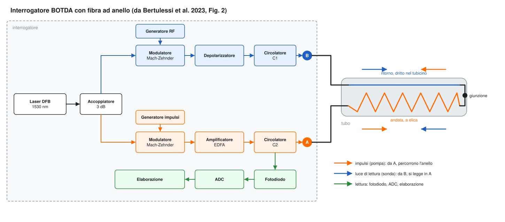

<!-- nav -->
| [← 1. Introduzione](01-introduzione.md) | [📖 Indice](00-indice.md) capitolo 2 di 11 · Parte I — Problema e principio di misura | [3. Configurazione del sensore →](03-il-sensore-sul-tubo.md) |
|:---|:---:|---:|
<!-- /nav -->

# 2. Principio di misura (BOTDA)

La BOTDA è una tecnica di misura già esistente e disponibile in commercio (§2.5). Questo capitolo la presenta come la
descrivono le fonti, soprattutto la scheda di OZ Optics [\[OZ\]](A-fonti.md#oz) e l'articolo di Bertulessi et al. [\[B23\]](A-fonti.md#b23). Il simulatore usa
lo strumento così com'è e ne riproduce l'uscita: gli spettri e la loro incertezza (cap. 6).

## 2.1 Diffusione Brillouin: dipendenza da deformazione e temperatura

La luce che attraversa la fibra interagisce con le onde acustiche del vetro e una parte torna indietro con la frequenza
spostata di circa 10,8 GHz [\[B23\]](A-fonti.md#b23). Lo spostamento, la **frequenza Brillouin** ν_B, varia linearmente con temperatura e
deformazione [\[B23\]](A-fonti.md#b23) Eq. 1, [\[OZ\]](A-fonti.md#oz):

  **Δν_B = C_T · ΔT + C_ε · ε**

dove:

| simbolo | nome | unità | valore |
|---|---|---|---|
| Δν_B | variazione della frequenza Brillouin rispetto a uno stato di riferimento | MHz | misurata |
| ΔT | variazione di temperatura della fibra | °C | — |
| ε | deformazione (allungamento relativo) della fibra; 1 µε = 1 µm di allungamento per metro | µε | — |
| C_T | coefficiente di temperatura | MHz/°C | circa 1 |
| C_ε | coefficiente di deformazione | MHz/µε | circa 0,05 |

I coefficienti dipendono dal cavo e dal modo in cui la fibra è vincolata [\[B23\]](A-fonti.md#b23), e vanno quindi calibrati (cap. 7).

## 2.2 Il principio BOTDA: panoramica

Secondo [\[OZ\]](A-fonti.md#oz) e [\[B23\]](A-fonti.md#b23):
1. la fibra forma un **anello** con i due capi collegati allo strumento (porta A e porta B);
2. due luci laser percorrono l'anello **in versi opposti**: una a impulsi (*pump*, impulso di interrogazione) e una
   continua (*probe*, luce di lettura);
3. dove la differenza di frequenza tra le due luci coincide con la ν_B locale, la luce continua viene **amplificata**;
4. la posizione si ricava dal tempo di arrivo del segnale, come in un OTDR: circa 10 ns per metro di andata e
   ritorno 🧮;
5. la grandezza si ricava **scansionando** la differenza di frequenza e stimando il **picco** dello spettro Brillouin.

Rispetto alla BOTDR, che usa un solo capo della fibra, la BOTDA offre misure più accurate e portate maggiori [\[OZ\]](A-fonti.md#oz).

## 2.3 Architettura dell'interrogatore

Lo schema a blocchi è ridisegnato da [\[B23\]](A-fonti.md#b23) Fig. 2 e §2.1, con i valori dello strumento usato in quell'articolo (fornito da
Cohaerentia).

| ramo | blocchi | funzione (valori di [\[B23\]](A-fonti.md#b23) §2.1) |
|---|---|---|
| sorgente | laser DFB a 1530 nm, accoppiatore 3 dB | un solo laser, diviso nei due rami |
| luce di lettura (sonda) | generatore RF, modulatore Mach-Zehnder, depolarizzatore, circolatore C1 | tono continuo a frequenza laser − Δν (Δν ≈ 10,8 GHz, scansionata), immesso dalla porta B |
| impulso (pompa) | generatore di impulsi, modulatore, amplificatore EDFA, circolatore C2 | impulsi di 20 ns (risoluzione circa 2 m) ripetuti a 30 kHz, immessi dalla porta A |
| ricezione | circolatore C2, fotodiodo da 125 MHz, ADC da 125 MS/s | la luce di lettura rientra dalla porta A ed è campionata ogni 0,8 m di fibra |
| elaborazione | ricostruzione dello spettro | per ogni posizione lo spettro di guadagno Brillouin e il suo picco ν_B |

## 2.4 Relazione con il simulatore

Il simulatore non riproduce i blocchi interni: parte da ν_B vera lungo la fibra e produce gli spettri che lo strumento
restituirebbe (dato grezzo L0), con la risoluzione, il passo, la scansione e il rumore impostati nello scenario. Il
modello dell'incertezza è quello di Soto & Thévenaz [\[ST13\]](A-fonti.md#st13) (cap. 6); ogni parametro è studiato nel **cap. 9**.

| livello | contenuto | chi lo produce |
|---|---|---|
| **L0** | per ogni punto e ogni misura, lo spettro (potenza in funzione della differenza di frequenza), con il rumore | il simulatore (cap. 6) |
| L1 | il picco ν_B(z, t) | l'elaborazione (fit, esempio nel cap. 6) |
| L2–L3 | allungamento, temperatura, pressione | l'elaborazione (esempio di compensazione nel cap. 7) |

## 2.5 Interrogatori BOTDA commerciali

**Lo strumento non va sviluppato: esiste ed è in vendita.** Gli interrogatori qui sotto lavorano ad anello (BOTDA) e
misurano deformazione e temperatura su fibre di chilometri. Per il progetto servono la fibra posata nella guaina e uno
di questi strumenti; il resto (pressione, compensazione) è elaborazione dei dati.

| strumento | tecnica e configurazione | portata | risoluzione spaziale | passo dei punti | accuratezza / ripetibilità dichiarata | tempo di misura | dati in uscita | stato |
|---|---|---|---|---|---|---|---|---|
| **Prysmian DITEST** [\[DIT\]](A-fonti.md#dit) | BOTDA ad anello o BOTDR; 4 canali (fino a 20) | 80 km per canale (anello fino a 160 km) | 1–20 m | 0,25–10 m | < 2 °C o < 40 µε (1σ) a 80 km, 5 m, 20 min | 1 s – 30 min | file txt/csv; protocolli Modbus, DNP3, IEC 61850 (opzioni) | ✅ scheda letta |
| **OZ Optics Foresight DSTS**, modulo BOTDA [\[OZ\]](A-fonti.md#oz) | BOTDA ad anello (combinazione con BOTDR opzionale); 2–251 canali | 100 km | 0,1–50 m (secondo il modello) | fino a 5 cm | ±2 µε, ±0,1 °C (2σ) | da 1 s (scansione completa) | — | ✅ scheda letta |
| **Neubrex NBX-7031** [\[NBX\]](A-fonti.md#nbx) | Brillouin PPP-BOTDA + Rayleigh TW-COTDR, su ordinazione | 50 m – 27 km (fino a 80 km nella versione UX) | fino a 2 cm (impulsi da 0,2 ns) | 5 cm (minimo 1 cm) | — | da 5 s | — | ✅ pagina prodotto letta |
| **Cohaerentia** (Milano) | BOTDA ad anello | — | 2 m in [\[B23\]](A-fonti.md#b23) | 0,8 m in [\[B23\]](A-fonti.md#b23) | migliore di 0,5 °C / 10 µε in [\[B23\]](A-fonti.md#b23) | 7–20 s in [\[B23\]](A-fonti.md#b23) | — | ⚠️ usato in [\[B23\]](A-fonti.md#b23); nessuna scheda prodotto trovata |

Altri strumenti trovati ma **non** adatti così come sono, o non verificati: fibrisTerre fTB 5020 (BOFDA, nel dominio della
frequenza; scheda non letta ⚠️); Viavi MTS-8000 DTSS (BOTDR, un capo solo; scheda non letta ⚠️). Dettagli e link
nell'appendice A, sezione "Prodotti commerciali".

**Come impostare il simulatore per riprodurre uno strumento** (🧮, con Δz = c·τ/(2n) e Δz = c/(2·n·f), n = 1,468):

| impostazione dello strumento | `pulse_width_ns` | `adc_sample_rate_msps` |
|---|---|---|
| DITEST, 1 m di risoluzione, passo 0,25 m | 9,8 | 408 |
| [\[B23\]](A-fonti.md#b23) / Cohaerentia, 2 m, passo 0,8 m | 20 | 125 |
| OZ, 0,1 m di risoluzione, passo 5 cm | 0,98 | 2041 |
| Neubrex, 2 cm, passo 5 cm | 0,2 | 2041 |

Verifica incrociata: per Neubrex la scheda dichiara 2 cm di risoluzione con impulsi da 0,2 ns, e la formula del
simulatore dà 2,04 cm. Le accuratezze dichiarate non bastano da sole a fissare il rumore del simulatore (dipendono da
medie e tempo di misura): per uno strumento scelto, `snr0_db` va tarato sui suoi dati (cap. 9, §9.1.5).

<!-- nav-fondo -->

| [← 1. Introduzione](01-introduzione.md) | [📖 Indice](00-indice.md) capitolo 2 di 11 · Parte I — Problema e principio di misura | [3. Configurazione del sensore →](03-il-sensore-sul-tubo.md) |
|:---|:---:|---:|
<!-- /nav-fondo -->
