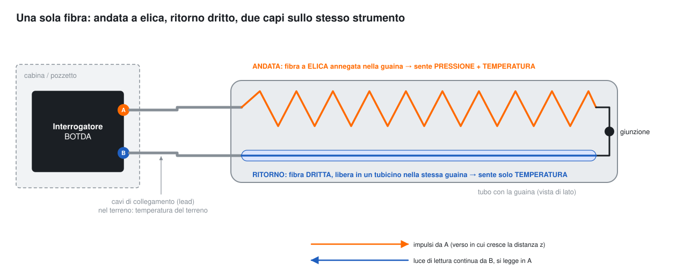

<!-- nav -->
| [← 2. Principio di misura (BOTDA)](02-principio-di-misura.md) | [📖 Indice](00-indice.md) capitolo 3 di 11 · Parte I — Problema e principio di misura | [4. Rete idraulica e scenari →](04-rete-idraulica-e-scenari.md) |
|:---|:---:|---:|
<!-- /nav -->

# 3. Configurazione del sensore

## 3.1 Percorso della fibra

*Schema modificabile in draw.io; si rigenera con `python docs/img/schemi.py`.*

Figura completa con didascalie: [blender/tubo_fibra.png](../blender/tubo_fibra.png).

## 3.2 Tratti della fibra e grandezze misurate

| tratto | posa | sente | nel simulatore (`leg`) |
|---|---|---|---|
| andata | **elica** a 70°, annegata nella guaina (MATRIS) o incollata fuori dal tubo (rete di prova, come [\[B23\]](A-fonti.md#b23)) | pressione + temperatura | `sensing` |
| giunzione | saldatura in fondo | temperatura del terreno | `junction` |
| ritorno | **dritto, libero in un tubetto** annegato nella stessa guaina | solo temperatura (✅ [\[B23\]](A-fonti.md#b23) Fig. 7c: non si sposta con la pressione) | `reference` |
| cavi | dalla cabina al tubo, nel terreno | temperatura del terreno | `lead` |

Decisione di posa MATRIS (appendice C, §13.4n): elica e ritorno nella stessa guaina, ritorno libero nel tubetto;
quindi vedono **la stessa temperatura nello stesso istante** (cap. 7).

## 3.3 Posa a elica

La pressione allarga soprattutto la **circonferenza** del tubo; una fibra dritta lungo l'asse sentirebbe poco.
L'elica raccoglie gran parte dell'allargamento: ε_fibra = ε_θ sin²α + ε_z cos²α (cap. 5). In più 1 m di tubo
contiene circa 2,9 m di fibra a 70°, quindi la risoluzione lungo il tubo migliora: 2 m di fibra ≈ 0,7 m di tubo ✅
[\[B23\]](A-fonti.md#b23) Eq. 2.

## 3.4 Corrispondenza tra fibra e tubo

Ogni punto del tubo compare due volte lungo la fibra: sull'andata (elica) e sul ritorno (dritto). Il simulatore
fornisce la mappa "metro di fibra → tubo e posizione sul tubo" (`fiber_map.csv`) per accoppiarli (cap. 7, 8).

## 3.5 Profilo a riposo e misura di base

A tubo vuoto ogni metro ha la sua frequenza, perché la posa tira la fibra in modo non uniforme ✅ [\[B23\]](A-fonti.md#b23) Fig. 7a.
Si cancella con la **misura di base** fatta a 0 bar. Nel simulatore: continuo lungo l'elica, salta solo dove la posa
riparte (cavo, cambio di tubo) ⚠️ ipotesi (appendice A).

<!-- nav-fondo -->

| [← 2. Principio di misura (BOTDA)](02-principio-di-misura.md) | [📖 Indice](00-indice.md) capitolo 3 di 11 · Parte I — Problema e principio di misura | [4. Rete idraulica e scenari →](04-rete-idraulica-e-scenari.md) |
|:---|:---:|---:|
<!-- /nav-fondo -->
