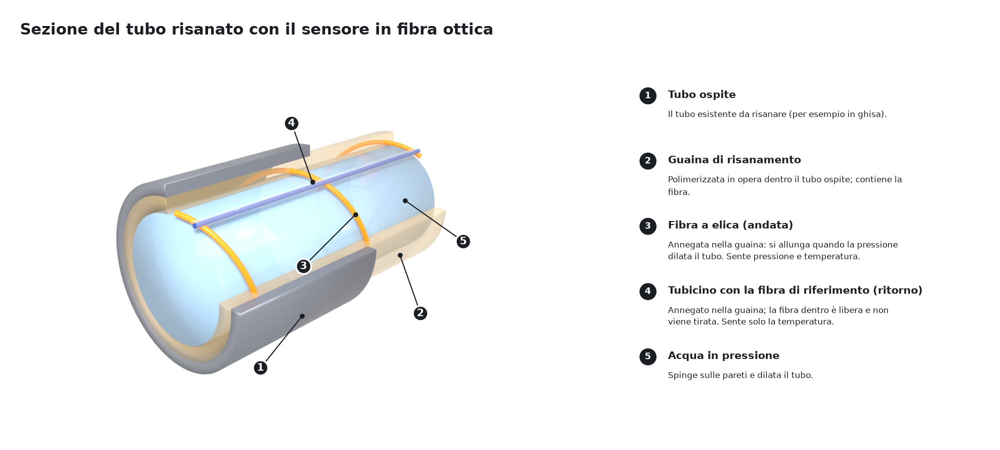

<!-- nav -->
| [← 4. Rete idraulica e scenari](04-rete-idraulica-e-scenari.md) | [📖 Indice](00-indice.md) capitolo 5 di 12 · Parte II — I modelli | [6. Modello dello strumento e dato grezzo →](06-strumento-e-dato-grezzo.md) |
|:---|:---:|---:|
<!-- /nav -->

# 5. Meccanica del tubo e della guaina

## 5.1 Tubo monostrato (soluzione di Lamé)

La pressione p allarga il tubo. Sulla superficie esterna (dove sta la fibra nella rete di prova) [\[B23\]](A-fonti.md#b23) Eq. 4–6:

$$\varepsilon_\theta = \frac{(2-\nu) \cdot \beta^2}{1-\beta^2} \cdot \frac{p}{E} \qquad \varepsilon_z = \frac{(1-2\nu) \cdot \beta^2}{1-\beta^2} \cdot \frac{p}{E} \qquad \beta = \frac{r_{int}}{r_{est}}$$

dove:

| simbolo | nome | unità | valore tipico (PE100) |
|---|---|---|---|
| $\varepsilon_\theta$ | deformazione circonferenziale (lungo il giro) sulla superficie esterna | µε | circa 309 per bar (SDR11) |
| $\varepsilon_z$ | deformazione assiale (lungo l'asse), tubo a fondi chiusi | µε | circa 39 per bar |
| $p$ | pressione interna dell'acqua | MPa (0,1 MPa = 1 bar) | — |
| $E$ | modulo elastico del materiale del tubo | MPa | circa 1000 |
| $\nu$ | coefficiente di Poisson | — | 0,40 |
| $\beta$ | rapporto tra raggio interno e raggio esterno | — | 0,82 (SDR11) |
| $r_{int}$, $r_{est}$ | raggio interno ed esterno del tubo | m | — |

Per il PE100 SDR11 (E circa 1 GPa): circa 309 µε per bar sul giro, 277 µε sull'elica a 70°, **circa 14 MHz/bar**.
Con tubi SDR11 la sensibilità non dipende dal diametro (calcolo nostro).

## 5.2 Deformazione della fibra a elica

$$\varepsilon_{fibra} = \varepsilon_\theta \cdot \sin^2\alpha + \varepsilon_z \cdot \cos^2\alpha$$

(trasformazione della deformazione)

dove $\varepsilon_{fibra}$ è la deformazione lungo la fibra [µε], $\alpha$ l'angolo dell'elica rispetto all'asse del tubo [°], $\varepsilon_\theta$ e $\varepsilon_z$
come sopra. A 70° la fibra raccoglie l'88 % della deformazione del giro.

## 5.3 Tubo multistrato: tubo ospite e guaina

La figura mostra gli strati di un tubo risanato, dall'esterno verso l'interno; gli strati sono accorciati a gradini e
un quarto è tolto per vedere dentro:
1. **tubo ospite**: il tubo esistente; nel modello è lo strato esterno, con il suo modulo elastico (per la ghisa circa
   170 GPa);
2. **guaina di risanamento**: polimerizzata in opera e aderente al tubo ospite; è lo strato in cui sta la fibra;
3. **fibra a elica** (andata, in rosso): annegata nella guaina, a metà spessore nel modello; si allunga con la deformazione
   circonferenziale della guaina e misura quindi la pressione (più la temperatura);
4. **tubicino con la fibra di ritorno**: la stessa fibra (in rosso nella figura, che esce dal tubicino sul davanti)
   torna indietro dentro un tubicino annegato nella guaina; lì è libera, non si allunga e misura solo la temperatura
   (cap. 3 e 7);
5. **acqua in pressione**: la pressione $p$ agisce sulla faccia interna della guaina.

Il modello meccanico segue la stessa sequenza di strati: la pressione si trasmette dalla guaina al tubo ospite, e
l'allungamento della fibra dipende dalla rigidezza di entrambi.

Con la guaina la fibra sta **dentro** la guaina, e la guaina sta dentro il tubo ospite. Il simulatore risolve Lamé a
N strati incollati (spostamento e pressione continui alle interfacce, fondi chiusi) (calcolo nostro); con uno strato coincide con
la formula sopra (verificato nei test).

Risultati (cap. 11, esperimenti), MHz per bar sull'elica:

| caso | MHz/bar |
|---|---|
| PE DN110 nudo, fibra fuori | 13,2 |
| guaina in feltro (1,7 GPa) in PE DN160 | 10,4 |
| guaina in vetro (10 GPa) in PE DN160 | 3,1 |
| guaina in ghisa degradata (rigidezza 1/10) | 2,5–3,8 |
| **guaina in ghisa integra** | **0,4–0,5** (pari al rumore di una misura) |

## 5.4 Guaina in un tubo ospite rigido

La guaina dentro un tubo rigido viene schiacciata nello spessore, ma la sua circonferenza non può crescere più di
quella del tubo: la fibra a elica, che misura l'allungamento del giro, non si allunga. Una gomma morbida non aiuta
perché è incomprimibile: conta la rigidezza **confinata**, non solo il modulo E.

## 5.5 Strato comprimibile (ipotesi)

Uno strato di 10 mm con rigidezza confinata circa 70 MPa tra una pelle sottile (con la fibra) e la ghisa restituisce
circa **7 MHz/bar** (pelle in feltro) o 3 (pelle in vetro) (calcolo nostro). Materiale, creep e durata da verificare (cap. 12).

## 5.6 Limiti del modello

Elastico: il PE ha creep [\[B23\]](A-fonti.md#b23) (Burgers). A 5 bar il modello con il rilassamento torna con la misura di [\[B23\]](A-fonti.md#b23)
entro il 6 %, a 10 bar sottostima (cap. 11). La temperatura dilata il tubo: cap. 7.

<!-- nav-fondo -->

| [← 4. Rete idraulica e scenari](04-rete-idraulica-e-scenari.md) | [📖 Indice](00-indice.md) capitolo 5 di 12 · Parte II — I modelli | [6. Modello dello strumento e dato grezzo →](06-strumento-e-dato-grezzo.md) |
|:---|:---:|---:|
<!-- /nav-fondo -->
