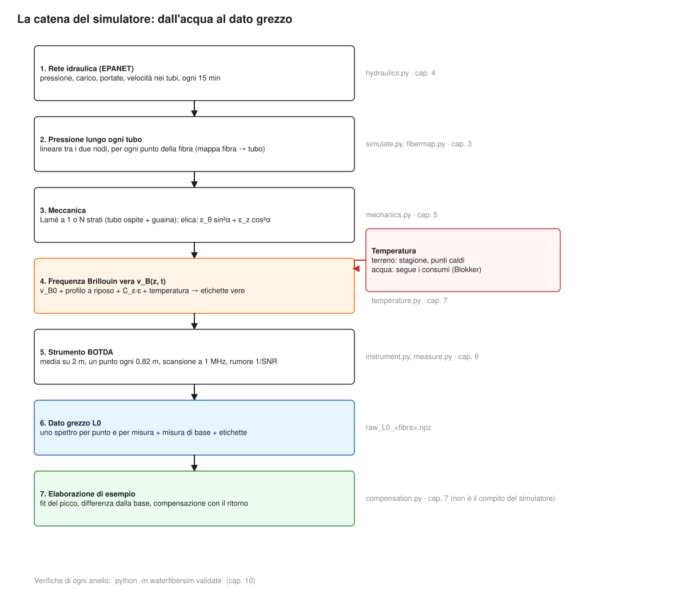

<!-- nav -->
| [← 7. Temperatura e compensazione](07-temperatura-e-compensazione.md) | [📖 Indice](00-indice.md) capitolo 8 di 11 · Parte III — Simulatore | [9. Parametri del simulatore →](09-parametri-del-simulatore.md) |
|:---|:---:|---:|
<!-- /nav -->

# 8. Logica del simulatore

Cosa fa, in che ordine, con quali ipotesi, e cosa abbiamo imparato. I parametri sono nella
[scheda tecnica](09-parametri-del-simulatore.md) (cap. 9), le fonti in [A-fonti.md](A-fonti.md), le verifiche in [validazione](10-validazione.md) (cap. 10).

## 8.1 Obiettivo del simulatore

Una fibra ottica posata lungo un tubo dell'acqua (a elica nella guaina di risanamento, con un ritorno libero) può
misurare la **pressione dell'acqua**, metro per metro, con uno strumento Brillouin (BOTDA)? Con quale errore, e dove
smette di funzionare? Il simulatore produce i dati che darebbe lo strumento (L0) e i valori veri (etichette), per
rispondere prima di andare in campo.

## 8.2 Catena di calcolo

*Schema modificabile in draw.io; si rigenera con `python docs/img/schemi.py`.*

Comandi: `map` (geometria), `run` (segnale vero), `instrument` (incertezza attesa), `measure` (dato grezzo L0),
`compensate [--measured]` (compensazione), `validate` (campagna di validazione).

## 8.3 Ipotesi di modello

1. Pressione lineare lungo il tubo tra due nodi; regime quasi stazionario (EPANET a scalini).
2. Materiali elastici lineari; il creep del PE non è modellato (a 5 bar sottostima circa il 20 %, vedi validazione).
3. Deformazione trasferita alla fibra al 100 %; elica e guaina incollate.
4. Ritorno libero nel tubetto: niente deformazione, stessa temperatura dell'elica nello stesso istante (posa nella guaina).
5. Strumento: rumore gaussiano bianco, nessuna polarizzazione, nessuno svuotamento della pompa, misura istantanea.
6. Temperatura dell'acqua: modello di Blokker, mescolamento nei nodi, velocità dell'ora corrente.

## 8.4 Sintesi della validazione

| verifica | esito |
|---|---|
| idraulica: perdita di carico contro la formula ufficiale di EPANET | coincide |
| meccanica: spostamento misurato da [\[B23\]](A-fonti.md#b23) a 5 bar (73 MHz) | 69 MHz con il rilassamento del PE, 56 MHz solo elastico |
| meccanica a 10 bar (200 MHz misurati) | 138 MHz: oltre i 5 bar il PE non è più lineare (creep) |
| strumento: punto di validazione di [\[ST13\]](A-fonti.md#st13) (0,75 MHz) | 0,76 MHz |
| strumento con le impostazioni di [\[B23\]](A-fonti.md#b23) (dichiarato < 0,5 MHz) | 0,40 MHz |
| tempo di volo: 125 MS/s → 0,8 m; 20 ns → 2 m | 0,82 m; 2,04 m (indice di gruppo da confermare) |
| fit sugli spettri | +17 % sulla formula: dipende dalla forma della campana, come prevede [\[ST13\]](A-fonti.md#st13) |
| compensazione su dato rumoroso contro formula | 0,059 contro 0,055 bar |

La catena è coerente con le fonti nelle condizioni di [\[B23\]](A-fonti.md#b23) (tubo in PE, pressioni fino a 5 bar). Le due differenze
(creep oltre 5 bar, fattore del fit) sono capite.

## 8.5 Risultati

1. **Sul tubo in PE la misura è fattibile.** Circa 13–14 MHz/bar sull'elica contro 0,4–0,5 MHz di rumore per misura:
   circa 0,03 bar per misura. La variazione giornaliera di una rete ben progettata (0,1–0,3 bar) si vede.
2. **La temperatura è il nemico principale, non il rumore.** 1 °C sull'elica pesa come 0,25–0,55 bar. Senza il
   ritorno libero la pressione assoluta è inutilizzabile (−3,3 bar con 8 °C); con il ritorno l'errore torna al rumore,
   **se** la sensibilità dell'elica alla temperatura (K) è nota. K oggi è incerto (3,5–8 MHz/°C): con 8 °C di
   differenza un errore su K vale ±1–1,4 bar. **Calibrare K in opera è il primo problema da risolvere.**
3. **L'acqua cambia temperatura con i consumi.** In una strada di 1 km l'acqua che arriva veloce di giorno porta la
   temperatura del serbatoio, di notte si porta al terreno. Senza compensazione la variazione giornaliera della
   pressione può avere il **segno sbagliato** (S1w). Con il ritorno nella stessa guaina si toglie.
4. **La misura di base va mediata.** Il suo rumore è uguale in tutte le misure successive e non si toglie mediando
   nel tempo: con 10 misure di base l'errore congelato scende di circa 3 volte.
5. **La guaina dentro un tubo rigido integro sente poco** (circa 0,4–0,5 MHz/bar, pari al rumore di una misura):
   la pressione si vedrebbe solo mediando molto, e allora domina l'errore della temperatura. Su ospite in PE o
   **degradato** la guaina lavora e la fibra sente 2,5–10 MHz/bar. Sul tubo rigido serve quindi una soluzione
   costruttiva diversa (punto 6).
6. **L'idea dello strato comprimibile funziona sulla carta.** Uno strato di 10 mm con rigidezza confinata circa
   70 MPa tra guaina sottile e ghisa dà circa 7 MHz/bar (metà del PE nudo); con una guaina rigida in vetro, circa
   3 MHz/bar. Restano da verificare materiali reali, creep, durata, idoneità all'acqua potabile.
7. **I punti dove la finestra di 2 m mescola tratti diversi** (giunzione, cavi) danno spettri a più picchi e vanno
   scartati: il simulatore li segna.

## 8.6 Sviluppi futuri

Creep del PE; temperatura del serbatoio che cambia nel tempo; ritardo termico della parete; polarizzazione e altri
rumori dello strumento; transitori (colpo d'ariete, DAS); perdite d'acqua (passo 4); rete reale.

<!-- nav-fondo -->

| [← 7. Temperatura e compensazione](07-temperatura-e-compensazione.md) | [📖 Indice](00-indice.md) capitolo 8 di 11 · Parte III — Simulatore | [9. Parametri del simulatore →](09-parametri-del-simulatore.md) |
|:---|:---:|---:|
<!-- /nav-fondo -->
