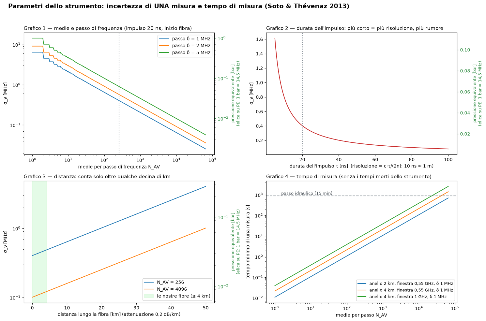
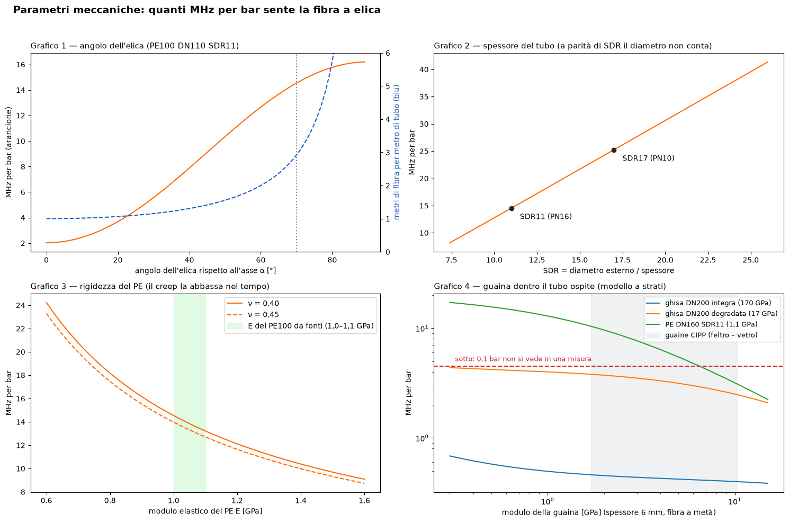
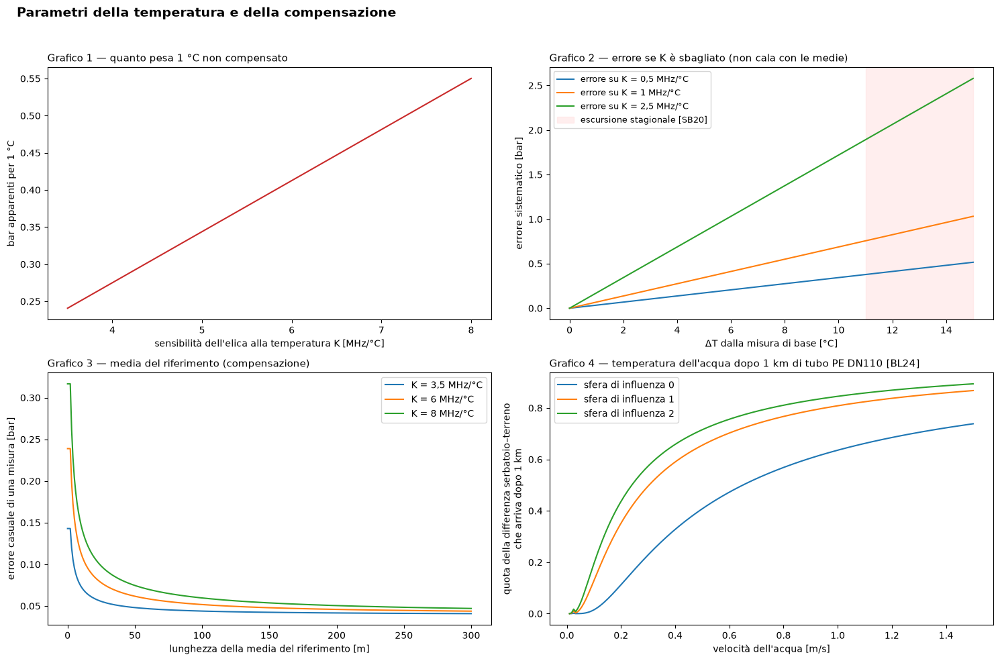
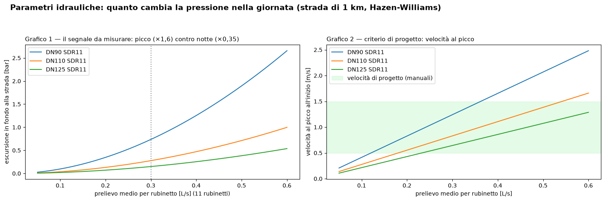

<!-- nav -->
| [← 9. Logica del simulatore](09-logica-del-simulatore.md) | [📖 Indice](00-indice.md) capitolo 10 di 12 · Parte III — Simulatore | [11. Validazione →](11-validazione.md) |
|:---|:---:|---:|
<!-- /nav -->

# 10. I parametri del simulatore

Un **parametro** è una variabile che si può cambiare: un valore nel file della rete (`.inp`), nello scenario
(`scenario_paths/*.yaml`), nei parametri dei tubi (`pipes.yaml`) o, per poche scelte di modello, una costante nel
codice. Per ognuno questo capitolo dice: **cos'è**, **dove si imposta**, **come entra** nel modello, il **valore** con la
sua fonte, **cosa succede se lo cambi** (calcolato dal simulatore) e il **compromesso**.

I grafici si rigenerano con `python -m waterfibersim parameters` (modulo `parameters.py`): usano le stesse funzioni del
simulatore, su un tubo PE100 DN110 SDR11 e uno strumento con le impostazioni di [\[B23\]](A-fonti.md#b23). Quando un grafico è in MHz,
l'asse di destra dà l'equivalente in bar sull'elica in PE (1 bar ≈ 14,5 MHz). Simboli delle fonti come nell'appendice A.

## 10.1 Parametri dello strumento

Tutte entrano nell'incertezza di una misura attraverso il modello di Soto & Thévenaz [\[ST13\]](A-fonti.md#st13) Eq. 7–9 (cap. 6):

$$\sigma_\nu = \frac{1}{\mathrm{SNR}}\sqrt{\frac{3 \cdot \delta \cdot \Delta\nu_B}{8 \cdot \sqrt{2} \cdot (1-\eta)^{3/2}}} \qquad \mathrm{SNR} = \mathrm{SNR}_0 \cdot \frac{\Delta z}{\Delta z_0} \cdot \sqrt{N_{AV}} \cdot e^{-\alpha z}$$

### 10.1.1 Durata dell'impulso `pulse_width_ns`

- **Cos'è.** Quanto dura ogni impulso di interrogazione (pompa). Lo strumento fa la media su tutta la fibra che
  l'impulso occupa: è la **risoluzione spaziale**, $\Delta z = c \cdot \tau/(2 \cdot n)$ [\[ST13\]](A-fonti.md#st13) §2.
- **Valore.** 20 ns → 2,04 m [\[B23\]](A-fonti.md#b23). Gli strumenti commerciali vanno da 0,2 ns (2 cm, Neubrex) a centinaia di ns .
- **Se lo cambi (grafico 2).** L'SNR è proporzionale a $\Delta z$: impulso di 10 ns → σ = 0,81 MHz (doppia); 50 ns → 0,16 MHz.
  Lungo il tubo, con l'elica a 70°, 2 m di fibra coprono circa 0,7 m di tubo [\[B23\]](A-fonti.md#b23) Eq. 2.
- **Attenzione.** Il grafico tiene fissa la larghezza della campana (58 MHz); con impulsi più corti la campana si
  allarga [\[ST13\]](A-fonti.md#st13) e l'incertezza peggiora ancora: sotto i 20 ns il grafico è ottimista (da verificare) (legge non nota).
- **Compromesso.** Risoluzione contro rumore. Per la pressione, che cambia lentamente lungo il tubo, 2 m bastano;
  servirebbe di più solo per localizzare eventi brevi (giunti, perdite).

### 10.1.2 Frequenza dell'ADC `adc_sample_rate_msps`

- **Cos'è.** Quante volte al secondo lo strumento legge il fotodiodo. Fissa il **passo dei punti**:
  $\Delta z = c/(2 \cdot n \cdot f_{ADC})$ (calcolo nostro) (tempo di volo).
- **Valore.** 125 MS/s → 0,82 m [\[B23\]](A-fonti.md#b23); commerciali 0,01–10 m [\[DIT\]](A-fonti.md#dit), [\[OZ\]](A-fonti.md#oz), Neubrex.
- **Se lo cambi.** Più punti, non più informazione: due punti più vicini della risoluzione condividono gran parte della
  stessa fibra, quindi il loro rumore è **correlato** (calcolo nostro). Non cambia σ.
- **Consiglio.** Un passo di circa metà risoluzione (come 0,8 m su 2 m) è sufficiente.

### 10.1.3 Passo di frequenza `freq_step_mhz` ($\delta$) e finestra `scan_window_ghz`

- **Cos'è.** Lo strumento costruisce la campana provando tante differenze di frequenza $\Delta\nu$, a passi di $\delta$, dentro la
  finestra.
- **Valore.** $\delta$ = 1 MHz, finestra 10,75–11,3 GHz [\[B23\]](A-fonti.md#b23) Tab. 1 (fase II).
- **Se lo cambi (grafico 1).** σ ∝ √$\delta$: con $\delta$ = 5 MHz σ = 0,90 MHz contro 0,40. Il tempo di misura è proporzionale al
  numero di passi = finestra / $\delta$.
- **La finestra** deve contenere tutti i picchi con mezza campana di margine: profilo a riposo (fino a +180 MHz),
  pressione (circa +100 MHz a 7 bar) e temperatura (6 MHz/°C sull'elica). Il comando `instrument` la controlla: oggi
  il margine è circa 120 MHz, cioè circa 20 °C sull'elica.
- **Compromesso.** $\delta$ e medie pesano allo stesso modo sull'incertezza; ma cambiare frequenza è lento per lo strumento
  [\[ST13\]](A-fonti.md#st13) §3, quindi conviene un $\delta$ un po' più largo con più medie.

### 10.1.4 Medie `n_averages` ($N_{AV}$)

- **Cos'è.** Quante tracce lo strumento somma per ogni passo di frequenza.
- **Valore.** 256 [\[B23\]](A-fonti.md#b23); commerciali fino a 65 000 [\[OZ\]](A-fonti.md#oz).
- **Se lo cambi (grafico 1).** σ ∝ 1/√$N_{AV}$ [\[ST13\]](A-fonti.md#st13): 256 → 0,40 MHz; 4096 → 0,10 MHz (circa 0,007 bar).
- **Il prezzo (grafico 4).** Il tempo cresce come $N_{AV}$: con 256 medie su un anello di 4 km circa 5,5 s (senza tempi
  morti, [\[B23\]](A-fonti.md#b23) dichiara 7–20 s); con 65 000 medie si superano i 15 minuti del passo idraulico.
- **Consiglio.** È il parametro più utile: il tempo c'è (la pressione cambia in ore). Fino a qualche migliaio di medie.

### 10.1.5 Prestazioni dello strumento: `snr0_db`, `snr0_resolution_m`, `linewidth_mhz`

- **Cos'è.** $\mathrm{SNR}_0$ riassume potenze, rivelatore e perdite: SNR della traccia all'inizio della fibra con una sola media.
  `linewidth_mhz` è la larghezza della campana.
- **Valore.** $\mathrm{SNR}_0$ = 0 dB a 2 m, valore indicato come realistico [\[ST13\]](A-fonti.md#st13); campana 58 MHz a 2 m [\[ST13\]](A-fonti.md#st13).
- **Se lo cambi.** σ ∝ 1/$\mathrm{SNR}_0$ e ∝ √$\Delta\nu_B$. Con questi valori il modello dà 0,40 MHz per le impostazioni di [\[B23\]](A-fonti.md#b23), che
  dichiara meno di 0,5 MHz (cap. 11).
- **Da sapere.** [\[B23\]](A-fonti.md#b23) dichiara SNR > 40 dB, che con [\[ST13\]](A-fonti.md#st13) darebbe incertezze 500 volte più piccole: definizioni
  diverse (da verificare). Questo parametro va **tarato sullo strumento vero**, il giorno che lo si sceglie.

### 10.1.6 Proprietà della fibra e passo di calcolo: `attenuation_db_per_km`, `group_index`, `calc_step_m`

- **Attenuazione** 0,2 dB/km [\[ST13\]](A-fonti.md#st13). Grafico 3: a 4 km σ passa da 0,40 a 0,49 MHz; a 50 km 4 MHz. Per i nostri
  anelli (≤ 4 km) è irrilevante.
- **Indice di gruppo** n = 1,468 (da verificare) (scheda Corning da leggere). Sposta i metri del 2 %, non le incertezze.
- **Passo di calcolo** 0,1 m: non è lo strumento, è la griglia su cui il simulatore calcola la verità; deve essere
  ≤ 1/10 della risoluzione (controllato).

## 10.2 Parametri meccanici

Entrano nella deformazione della fibra (cap. 5): Lamé (uno o più strati) e $\varepsilon_{fibra}$ = $\varepsilon_\theta$ sin²$\alpha$ + $\varepsilon_z$ cos²$\alpha$, poi
$\Delta\nu$ = $C_\varepsilon$ · $\varepsilon$.

### 10.2.1 Angolo dell'elica `angle_deg`

- **Valore.** 70° (da verificare) scelto; [\[B23\]](A-fonti.md#b23) circa 75°.
- **Se lo cambi (grafico 1).** 0° (fibra dritta): 2,0 MHz/bar; 45°: 9,1; 70°: 14,5; 80°: 15,8. Ma la fibra per metro
  di tubo cresce come 1/cos $\alpha$: 2,9 m a 70°, 5,8 m a 80° (curva blu).
- **Compromesso.** Oltre 70° si guadagna poco segnale e si raddoppia la fibra (e quindi la lunghezza dell'anello,
  il tempo di misura e il costo). 70° è un buon punto.

### 10.2.2 Spessore del tubo (SDR) e diametro

- **Valore.** PE100 SDR11 schede Uponor, Aliaxis.
- **Se lo cambi (grafico 2).** La sensibilità dipende solo dal rapporto diametro/spessore: SDR11 14,5 MHz/bar, SDR17
  25 MHz/bar (calcolo nostro). A parità di SDR il diametro non conta.
- **Compromesso.** Tubi più sottili sentono di più ma reggono meno pressione (SDR17 = PN10). Il tubo lo sceglie
  l'acquedotto, non il sensore.

### 10.2.3 Modulo elastico `E_GPa` e Poisson `nu`

- **Valore.** E = 1,0 GPa (scenari), 1,05 [\[B23\]](A-fonti.md#b23), 1,1 (scheda) ; $\nu$ = 0,40 [\[B23\]](A-fonti.md#b23), 0,42–0,49 con la temperatura [\[SB20\]](A-fonti.md#sb20) .
- **Se lo cambi (grafico 3).** MHz/bar ∝ 1/E: 1,0 → 14,5; 1,1 → 13,2. $\nu$ pesa pochi per cento.
- **Attenzione.** Il PE fa **creep**: sotto pressione costante E apparente cala nel tempo [\[B23\]](A-fonti.md#b23). È un errore
  sistematico sulla conversione MHz → bar se non calibrato (cap. 10: −20 % a 5 bar dopo minuti).

### 10.2.4 Guaina e tubo ospite (`liner`)

- **Valore.** 6 mm, 8 GPa, $\nu$ 0,35 (da verificare); letteratura: CIPP in feltro almeno 1,7 GPa (ASTM F1216), in vetro circa 10 GPa
  (scheda di una guaina per fognatura) (da verificare). I valori veri vanno presi dal laminato reale.
- **Se lo cambi (grafico 4).** È il parametro **decisivo**:
  - in un tubo ospite in PE la guaina lavora: 3–17 MHz/bar, più la guaina è morbida più si sente;
  - in ghisa degradata (rigidezza 1/10): 2–4 MHz/bar;
  - **in ghisa integra: 0,4–0,7 MHz/bar, qualunque sia la guaina**: la pressione la regge il tubo, la fibra quasi non
    si allunga (cap. 5).
- **Soglia pratica.** Con il rumore di [\[B23\]](A-fonti.md#b23) servono almeno circa 4,5 MHz/bar per vedere 0,1 bar in una misura
  (linea rossa).

## 10.3 Parametri termici e di compensazione

### 10.3.1 Sensibilità dell'elica alla temperatura `helix_mhz_per_c` (K)

- **Cos'è.** Quanti MHz sposta l'elica per 1 °C: 1 MHz/°C della fibra più la dilatazione del tubo che la tira.
- **Valore.** 6 MHz/°C; forbice da fonti 3,5 ([\[B23\]](A-fonti.md#b23) con K_T) – 8 ([\[SB20\]](A-fonti.md#sb20), tubo trattenuto) (da verificare).
- **Se lo cambi (grafico 1).** 1 °C non compensato vale 0,24–0,55 bar apparenti.
- **Se è sbagliata (grafico 2).** Errore sistematico = ΔK·$\Delta T$ / (MHz per bar): con 1 MHz/°C di errore e 10 °C dalla misura
  di base, 0,69 bar; con l'escursione stagionale (11–15 °C [\[SB20\]](A-fonti.md#sb20)) anche di più. Non cala con le medie.
- **Consiglio.** È il parametro più incerto e più pesante: va **calibrato in opera** (metodo da cercare, cap. 12).

### 10.3.2 Temperatura del terreno: `baseline_c`, `soil_c`, `drift_c_per_day`, `hotspots`

- **Valore.** S1t: 18 → 10 °C, −0,15 °C/giorno [\[SB20\]](A-fonti.md#sb20) (11–15 °C in 90 giorni); punti caldi fino a 7–10 °C [\[AV17\]](A-fonti.md#av17),
  posizione e ampiezza (da verificare) scelte. `delta_c` può essere positivo o negativo.
- **Eventi.** Un punto caldo può avere un orario (`from_h`, `to_h`): allora è un **evento**, presente solo in quelle ore
  (in S1th: +4 °C su P3 dalle 14 alle 17, scelto per mostrare l'effetto).
- **Effetto.** $\Delta T$ dalla misura di base, uguale per elica e ritorno nello stesso punto. Nel waterfall della differenza
  dalla misura di base (grafico 3 della figura del segnale) un punto caldo permanente è una banda verticale, un evento
  un rettangolo; nella variazione giornaliera (grafico 4) il punto caldo permanente sparisce, l'evento resta.

### 10.3.3 Temperatura dell'acqua: `water.source_c`, `soil_k_w_mk`, `pipe_k_w_mk`, `tsoi`

- **Cos'è.** L'acqua esce dal serbatoio a `source_c` e si avvicina al terreno con il tempo di permanenza [\[BL24\]](A-fonti.md#bl24).
- **Valore.** +2 °C sul terreno (da verificare) ([\[BL24\]](A-fonti.md#bl24) misura 0,6–1,6 °C); PE 0,38 W/(m·K) scheda; sabbia 1,6 [\[BL24\]](A-fonti.md#bl24);
  sfera di influenza 1 (da verificare) ([\[BL24\]](A-fonti.md#bl24): 1–2 raggi).
- **Se lo cambi (grafico 4).** Dopo 1 km a 0,8 m/s arriva ancora il 77 % della differenza serbatoio–terreno; a
  0,1 m/s (notte) solo il 13 %. La sfera di influenza sposta le curve, non la conclusione: **la temperatura dell'acqua
  segue i consumi** nelle reti piccole.

### 10.3.4 Media della fibra di riferimento

- **Cos'è.** Su quanti metri del ritorno si media la temperatura prima di toglierla dall'elica (`compensate`).
- **Se lo cambi (grafico 3).** Punto per punto: 0,14–0,32 bar di errore casuale (secondo K); mediata su 74 m:
  0,045–0,065 bar. Oltre circa 100 m si guadagna poco: resta il rumore dell'elica.
- **Compromesso.** La media **mobile** sfuma le variazioni locali (fino a 0,6 bar ai bordi di un punto caldo); la
  media **adattiva** (soglia 2σ, mediana su 10 m (da verificare)) le conserva (0,2 bar), con poco rumore in più.
- **Misura di base.** Mediarne 10 riduce di circa 3 volte l'errore "congelato" (cap. 7).

## 10.4 Parametri idraulici

- **Prelievi, diametri, scabrezza** (`.inp`). Il segnale da misurare è l'escursione giornaliera di pressione: in fondo
  a una strada di 1 km con 11 rubinetti da 0,3 L/s in DN110 circa 0,28 bar (grafico 1, formula di Hazen-Williams
  [\[EPA\]](A-fonti.md#epa) Tab. 3.1). Raddoppiando i prelievi l'escursione cresce di circa 3,6 volte (perdita ∝ Q^1,852).
- **Criteri di progetto** (grafico 2): una rete ben progettata tiene la velocità al picco tra 0,5 e 1,5 m/s (da verificare)
  (manuali; EN 805 da leggere), e quindi **escursioni piccole**: 0,1–0,3 bar. È il motivo per cui il sensore deve
  arrivare a pochi centesimi di bar.
- **Quota e pendenza** (`Elev` dei nodi, testa del serbatoio): danno pressione statica (circa 0,1 bar/m), fissa nel
  tempo (cap. 4).

## 10.5 Tabella riassuntiva

### Rete e idraulica (file `.inp` di EPANET)

| parametro | default | intervallo | fonte | peso sul risultato |
|---|---|---|---|---|
| diametro interno dei tubi | da OD − 2·spessore (PE100 SDR11) | catalogo | verificato schede Uponor, Aliaxis | perdita di carico ∝ D^−4,87: decide la variazione di pressione |
| scabrezza Hazen-Williams C | PE 140, ghisa 130 | 130–150 (nuovi) | verificato [\[EPA\]](A-fonti.md#epa) Tab. 3.2 | perdita ∝ C^−1,852 |
| consumi (`Demand`) e andamento giornaliero (`DAILY`) | 0,3 L/s per rubinetto (S1), 4 L/s per utenza (griglia); punte 1,6 × alle 8 e alle 19 | — | da verificare scelti per stare nei criteri di progetto | è il "segnale" idraulico: 0,04–0,8 bar di escursione |
| criteri di progetto (velocità 0,5–1,5 m/s, perdita ≤ 10 m/km) | — | — | da verificare corsi e manuali; EN 805 da leggere | servono a non inventare reti irrealistiche |
| quota del pelo dell'acqua del serbatoio | 50 m sul tubo (circa 4,9 bar) | — | da verificare scelta | pressione statica |
| pendenza della strada | 0 % o 2 % | — | da verificare scelta | +1 bar ogni 10 m di discesa, fisso nel tempo |
| passo idraulico | 15 min | — | scelta | i consumi cambiano a scalini di un'ora |

Verifica: la perdita di carico di EPANET coincide con la formula di [\[EPA\]](A-fonti.md#epa) Tab. 3.1 (`validate`).

### Tubo e guaina (`pipes.yaml`, modello in `mechanics.py`)

| parametro | default | intervallo | fonte | peso |
|---|---|---|---|---|
| E del PE100 | 1,0 GPa | 1,05 ([\[B23\]](A-fonti.md#b23)); 1,1 (scheda) | verificato | MHz/bar ∝ 1/E |
| $\nu$ del PE | 0,40 | 0,42–0,49 con la temperatura | verificato [\[B23\]](A-fonti.md#b23), [\[SB20\]](A-fonti.md#sb20) | pochi % |
| creep del PE (Burgers E2, $\eta$2, $\eta$3) | non modellato | E2 = 1,65–4,47 GPa | verificato [\[B23\]](A-fonti.md#b23) Tab. 2 | +20 % a 5 bar dopo minuti; oltre a 10 bar molto di più |
| ghisa: E, $\nu$ | 170 GPa, 0,26 | — | da verificare (scheda con unità errata) | rende il tubo quasi indeformabile |
| guaina: spessore, E, $\nu$ | 6 mm, 8 GPa, 0,35 | E 1,7 (feltro, minimo ASTM F1216) – 10,3 GPa (vetro UV) | da verificare da laminato reale | **decide se la pressione si vede** |
| posizione della fibra nella guaina | metà spessore | — | da verificare | piccolo |
| angolo dell'elica | 70° | 60–80° | da verificare scelto; [\[B23\]](A-fonti.md#b23) 75° | $\varepsilon_{fibra}$ = $\varepsilon_\theta$ sin²$\alpha$ + $\varepsilon_z$ cos²$\alpha$ |

Sensibilità dell'elica alla pressione (modello a strati, `validate`): PE DN110 senza guaina circa 13–14 MHz/bar; guaina
in tubo in PE 3–10 MHz/bar; **guaina in ghisa integra circa 0,4–0,5 MHz/bar** (pari al rumore di una misura).

### Fibra e posa (`scenario_paths/*.yaml`, sezione della fibra)

| parametro | default | fonte | note |
|---|---|---|---|
| tratto di misura | elica, `bonded` (rete di prova) o `embedded` (guaina di risanamento) | verificato [\[B23\]](A-fonti.md#b23); decisione utente | sente pressione + temperatura |
| tratto di riferimento | dritto, libero in un tubicino | verificato [\[B23\]](A-fonti.md#b23) Fig. 7c; scelta di progetto | sente solo temperatura |
| cavi (`lead`) e giunzione | lunghezze nello scenario | — | sentono la temperatura del terreno |
| indice di gruppo n | 1,468 | da verificare a memoria (scheda Corning da scaricare) | sposta i metri del 2 % |
| attenuazione | 0,2 dB/km | verificato [\[ST13\]](A-fonti.md#st13) | sotto i 4 km pesa poco |
| $C_\varepsilon$, $C_T$ | 0,05 MHz/µε, 1 MHz/°C | verificato [\[B23\]](A-fonti.md#b23) Eq. 1 (dipendono dal cavo) | errore di calibrazione = errore sistematico |
| $\nu_{B0}$ | 10 880 MHz | da verificare da [\[B23\]](A-fonti.md#b23) Fig. 7a a occhio | non cambia le differenze |
| profilo a riposo | elica 105–180 MHz continuo, tubicino +65 MHz, ondulazioni 1 MHz | verificato valori [\[B23\]](A-fonti.md#b23), da verificare forma | si cancella con la misura di base |
| passo di calcolo `calc_step_m` | 0,1 m | scelta | ≤ 1/10 della risoluzione, non è lo strumento |

### Interrogatore (sezione `interrogator`)

| parametro | default | intervallo commerciale | fonte | effetto |
|---|---|---|---|---|
| durata dell'impulso | 20 ns → 2,04 m | 0,2 ns – 500 ns | verificato [\[B23\]](A-fonti.md#b23); Neubrex, OZ, [\[DIT\]](A-fonti.md#dit) | risoluzione; SNR ∝ $\Delta z$ |
| campionamento ADC | 125 MS/s → 0,82 m | 0,01–10 m | verificato [\[B23\]](A-fonti.md#b23); [\[DIT\]](A-fonti.md#dit), [\[OZ\]](A-fonti.md#oz) | passo dei punti |
| passo di frequenza $\delta$ | 1 MHz | 1–5 MHz | verificato [\[B23\]](A-fonti.md#b23) Tab. 1 | σ ∝ √$\delta$; tempo ∝ 1/$\delta$ |
| medie $N_{AV}$ | 256 | 1–65 000 | verificato [\[B23\]](A-fonti.md#b23), [\[OZ\]](A-fonti.md#oz) | σ ∝ 1/√$N_{AV}$; tempo ∝ $N_{AV}$ |
| finestra di scansione | 10,75–11,3 GHz | — | verificato [\[B23\]](A-fonti.md#b23) | deve contenere i picchi (margine circa 120 MHz ≈ 10 °C sull'elica) |
| larghezza della campana | 58 MHz a 2 m | 27–100 MHz | verificato [\[ST13\]](A-fonti.md#st13) | σ ∝ √$\Delta\nu_B$ |
| $\mathrm{SNR}_0$ | 0 dB a 2 m, 1 traccia | — | verificato [\[ST13\]](A-fonti.md#st13) "realistic" | σ ∝ 1/SNR |

Risultato (passo 3a, `instrument`): σ circa 0,40–0,46 MHz per misura (circa 0,03 bar sull'elica in PE); tempo minimo
circa 3–6 s per misura (tempi morti esclusi).

### Temperatura (sezione `temperature`)

| parametro | default (scenari) | fonte | effetto |
|---|---|---|---|
| terreno alla misura di base, oggi, deriva | 18 → 10 °C, −0,15 °C/giorno (S1t) | verificato [\[SB20\]](A-fonti.md#sb20) 11–15 °C in 90 giorni | 1 °C ≈ 0,25–0,55 bar apparenti |
| sensibilità dell'elica alla temperatura K | 6 MHz/°C | da verificare forbice 3,5 ([\[B23\]](A-fonti.md#b23) K_T) – 8 ([\[SB20\]](A-fonti.md#sb20)) | **parametro più incerto: va calibrato** |
| punti caldi locali | +3 °C su 40 m (S1th) | verificato ordine di grandezza [\[AV17\]](A-fonti.md#av17); da verificare posizione scelta | sembrano anomalie di pressione |
| acqua: temperatura alla sorgente | +2 °C sul terreno (S1w) | da verificare; [\[BL24\]](A-fonti.md#bl24) 0,6–1,6 misurati, 1–5 K nelle analisi | segue i consumi; può invertire il segno della variazione giornaliera |
| acqua: conducibilità PE e terreno, sfera di influenza | 0,38; 1,6 W/(m·K); 1 | verificato scheda PE100; verificato [\[BL24\]](A-fonti.md#bl24); da verificare | costante di tempo 1,3–2,4 h |

### Elaborazione di esempio (fit e compensazione)

| parametro | default | fonte | effetto |
|---|---|---|---|
| fit: soglia $\eta$ | 0,5 (±FWHM/2), 3 passate | verificato [\[ST13\]](A-fonti.md#st13) | +17 % di errore rispetto alla formula (forma lorentziana) |
| misura di base: numero di misure mediate | 1 | calcolo nostro | il suo rumore è "congelato": con 10 misure circa 3 volte meno |
| media del riferimento | 74 m (mobile o adattiva) | calcolo nostro | rumore 0,24 → 0,056 bar; la mobile sfuma i punti caldi |
| soglia della media adattiva | 2 σ del riferimento (dai dati), mediana su 10 m | da verificare scelte | conserva i punti caldi (0,22 contro 0,65 bar) |

<!-- nav-fondo -->

| [← 9. Logica del simulatore](09-logica-del-simulatore.md) | [📖 Indice](00-indice.md) capitolo 10 di 12 · Parte III — Simulatore | [11. Validazione →](11-validazione.md) |
|:---|:---:|---:|
<!-- /nav-fondo -->
