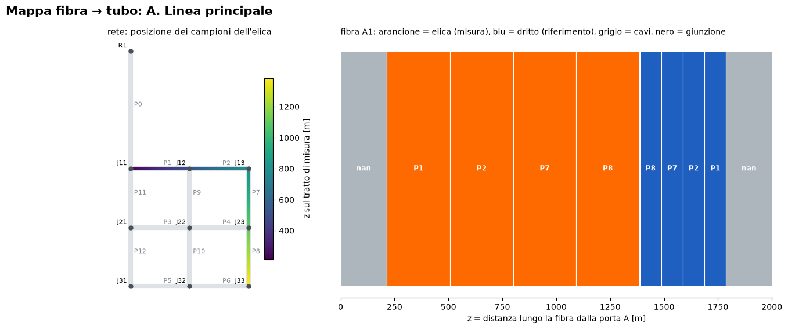
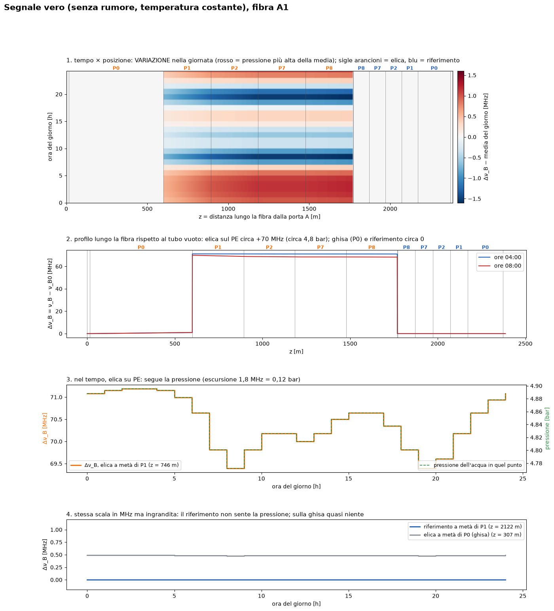
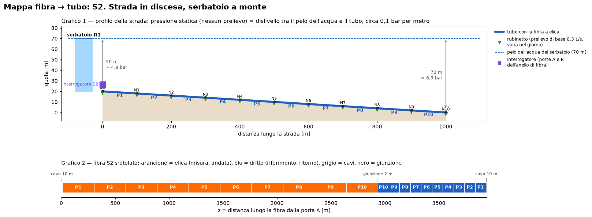
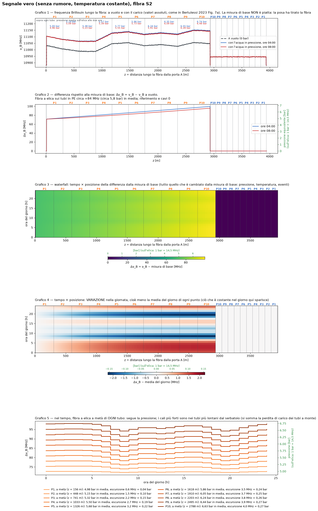
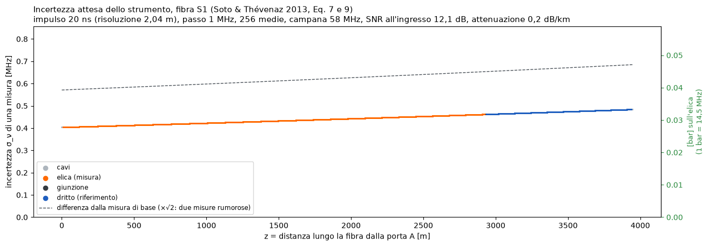
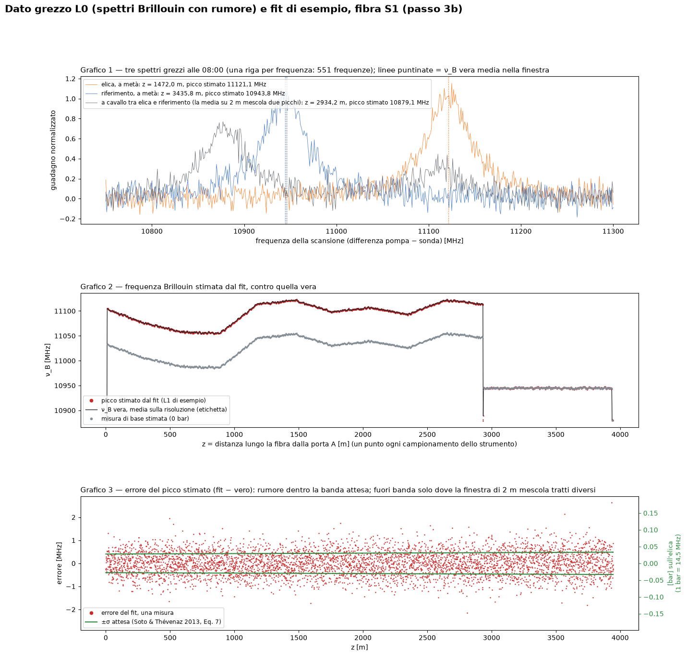
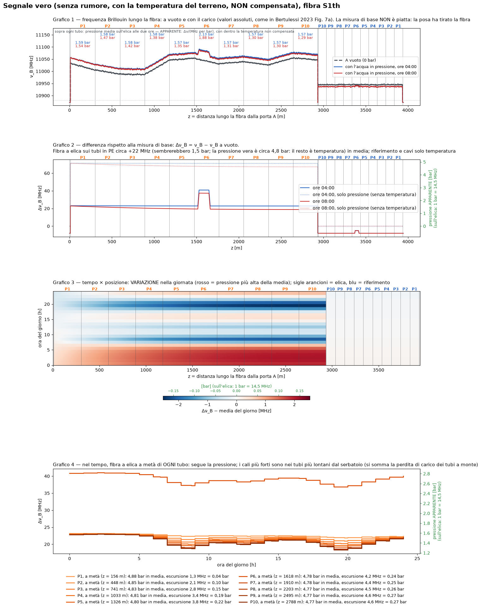
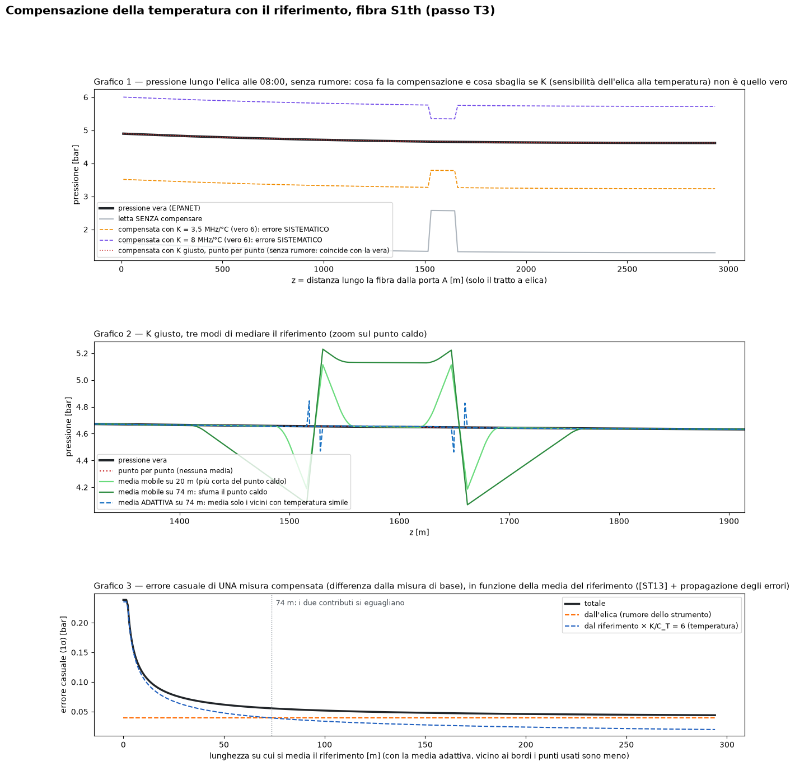
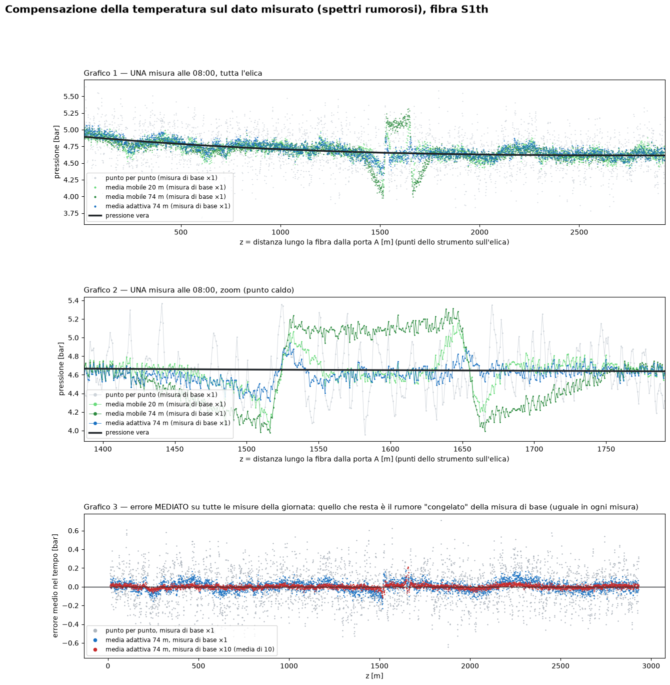
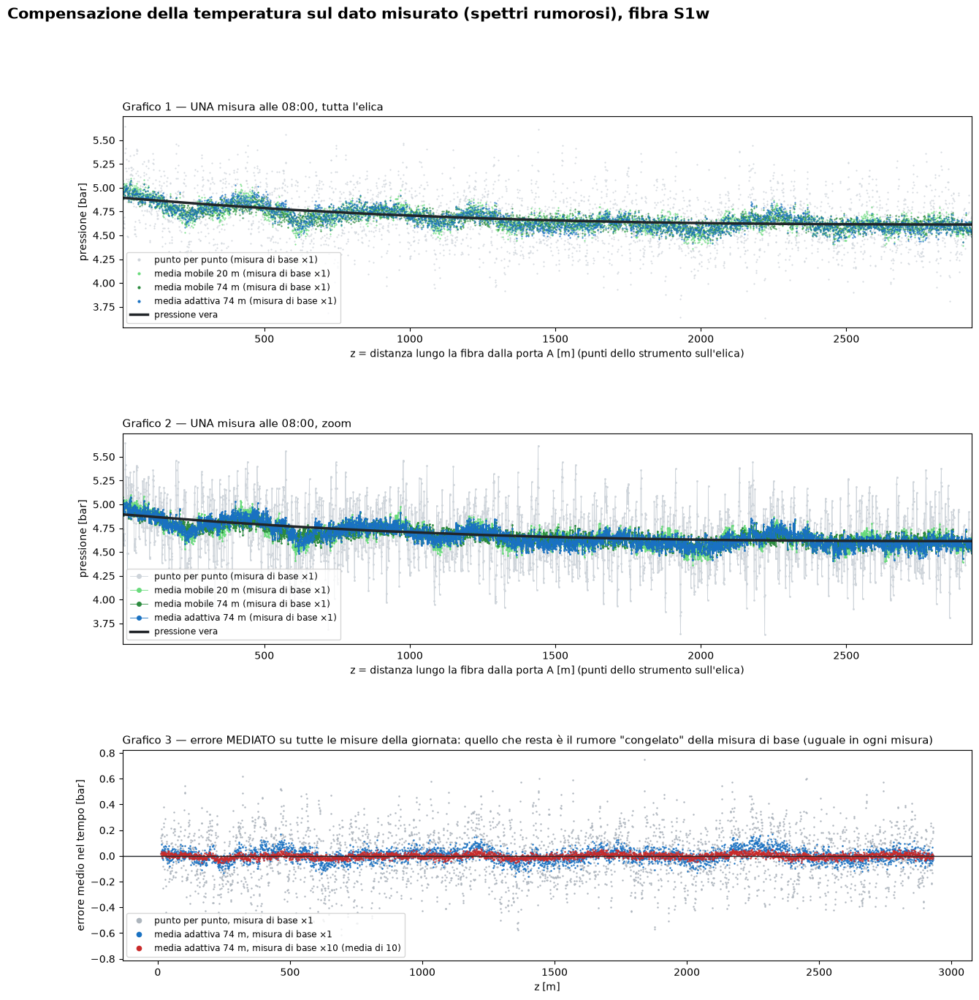

<!-- nav -->
| [← 11. Validazione](11-validazione.md) | [📖 Indice](00-indice.md)<br><sub>capitolo 12 di 13 · Parte IV — Esperimenti e conclusioni</sub> | [13. Risultati e questioni aperte →](13-risultati-e-questioni-aperte.md) |
|:---|:---:|---:|
<!-- /nav -->

# 12. Esperimenti preliminari

Prove fatte con il simulatore sugli scenari del cap. 4, nell'ordine in cui sono state eseguite. Per ognuna: scenario,
comando, figura e cosa se ne ricava. I numeri sono risultati del simulatore (calcolo nostro) con i parametri del cap. 10;
i modelli sono descritti nei cap. 5–7, il confronto con dati indipendenti nel cap. 11.

## 12.1 Mappa metro di fibra → tubo (scenario A)

```bash
python -m waterfibersim map scenario_paths/A_main_line.yaml --out out/A
```

Per ogni punto di calcolo lungo la fibra, contato dalla porta A, la mappa dice su quale tratto si trova (cavo, elica,
giunzione, ritorno), su quale tubo e a che distanza dall'inizio del tubo. Scenario A: 2001,5 m di fibra (2 × 215 m di
cavo + 400 m di tubo × 2,92 + 2 m di giunzione + 400 m di ritorno), 20 016 punti di calcolo ogni 0,1 m.



- **Ogni punto di un tubo compare due volte**: sull'elica e sul ritorno. È ciò che permette di separare pressione e
  temperatura (cap. 7).
- Sull'elica un metro di fibra copre meno di un metro di tubo: con $\alpha$ = 70° servono circa 2,9 m di fibra per metro
  di tubo ($1/\cos\alpha$). Sul ritorno, dritto, un metro di fibra è un metro di tubo, percorso all'indietro.
- Verifica: la lunghezza totale torna con la somma dei tratti, e ogni tubo coperto compare due volte (test automatici).

## 12.2 Segnale vero lungo la fibra

```bash
python -m waterfibersim run scenario_paths/A_main_line.yaml --out out/A --hours 24 --step-min 15
```

Il simulatore calcola, ogni 15 minuti, la frequenza Brillouin vera in ogni punto della fibra (senza rumore). La figura ha
cinque grafici: frequenza lungo la fibra, differenza dalla misura di base, waterfall nel tempo, variazione nel giorno,
andamento per tubo (cap. 8, §8.5).



Nello scenario A:
- sull'elica dei tubi in PE la frequenza sta circa 70 MHz sopra il tubo vuoto (circa 4,8 bar) e varia di 2–3 MHz nella
  giornata seguendo i consumi; la sensibilità è circa 14,5 MHz/bar con il modulo del PE degli scenari (1,0 GPa) e non
  dipende dal diametro, perché nei tubi SDR11 lo spessore è proporzionale al diametro;
- sul ritorno, sui cavi e sulla giunzione la deformazione è nulla;
- l'adduttrice in ghisa P0 non ha l'elica: su un tubo così rigido la fibra si allungherebbe troppo poco (cap. 5).

La rete di prova è dimensionata con criteri di progetto (cap. 4): nella giornata la pressione varia di circa 0,2 bar.

### Scenari semplici: quota e perdita di carico

```bash
python -m waterfibersim run scenario_paths/S2_street_downhill.yaml --out out/S2
```



| scenario | inizio, 03:00 → 08:00 | fine, 03:00 → 08:00 | escursione nel giorno (max) |
|---|---|---|---|
| S0a tubo, piano | 4,90 → 4,89 bar | 4,85 → 4,06 bar | 0,8 bar in fondo |
| S0b tubo, discesa | 4,90 → 4,89 bar | 6,81 → 6,02 bar | 0,8 bar in fondo |
| S1 strada, piano | 4,90 → 4,89 bar | 4,89 → 4,61 bar | 0,3 bar in fondo |
| S2 strada, discesa | 4,90 → 4,89 bar | 6,85 → 6,58 bar | 0,3 bar in fondo |

- **La quota dà una pendenza fissa**: lungo una discesa la pressione cresce di circa 1 bar ogni 10 m di dislivello, anche
  allontanandosi dal serbatoio, e non cambia nel tempo.
- **La perdita di carico dà la variazione nel tempo**: cresce nelle ore di punta ed è più forte lontano dal serbatoio.
- **Tubo singolo e strada**, con la stessa acqua prelevata: nel tubo singolo tutta la portata percorre tutto il tubo e la
  pressione cala di più (0,8 contro 0,3 bar); nella strada la portata diminuisce a ogni rubinetto.



## 12.3 Incertezza attesa dello strumento (scenario S1)

```bash
python -m waterfibersim instrument scenario_paths/S1_street_flat.yaml --out out/S1
```

Dai parametri dell'interrogatore il simulatore calcola, prima di generare il rumore, l'incertezza attesa lungo la fibra
con il modello di [\[ST13\]](A-fonti.md#st13) (cap. 6, §6.2). Con le impostazioni di [\[B23\]](A-fonti.md#b23) (20 ns, 1 MHz, 256 medie):

| | S1 (anello 3,9 km) | A (anello 2,0 km) |
|---|---|---|
| incertezza di una misura sull'elica | 0,40–0,46 MHz = 0,028–0,032 bar | 0,41–0,43 MHz = 0,028–0,030 bar |
| dopo la sottrazione della misura di base (× √2) | fino a 0,65 MHz = 0,045 bar | fino a 0,61 MHz = 0,042 bar |
| ritorno | 0,46–0,48 °C | 0,43–0,44 °C |
| tempo minimo di una misura (senza tempi morti) | 5,5 s | 2,8 s |



- In fondo alla strada S1 l'escursione giornaliera (0,27 bar) è circa 6 volte l'incertezza; vicino al serbatoio
  (0,04 bar) è pari all'incertezza: con una misura sola non si vede.
- Sulle lunghezze di questi scenari (2–4 km) la distanza pesa poco: circa +15 % di incertezza.
- Il comando controlla anche che tutti i picchi cadano nella finestra di scansione (margine circa 120 MHz).

## 12.4 Dato grezzo e stima del picco (scenario S1)

```bash
python -m waterfibersim measure scenario_paths/S1_street_flat.yaml --out out/S1 --every-min 60
```

Per ogni misura (una all'ora) e ogni punto dello strumento (ogni 0,82 m), lo spettro Brillouin intero (551 frequenze a
1 MHz) con il rumore, più la misura di base e un fit di esempio (cap. 6, §6.3–6.4). Il file `raw_L0_S1.npz` contiene
25 × 4831 × 551 valori (circa 130 MB) con le etichette vere.

| tratto | errore del fit misurato | previsto da [\[ST13\]](A-fonti.md#st13) |
|---|---|---|
| elica | 0,50 MHz (circa 0,035 bar) | 0,43 MHz |
| ritorno | 0,56 MHz | 0,47 MHz |



- Il fit di esempio fa circa il 17 % peggio della formula, anche su spettri sintetici: la formula assume una parabola,
  la campana è lorentziana; [\[ST13\]](A-fonti.md#st13) avverte che il fattore numerico dipende dalla forma.
- Dove la finestra di 2 m prende tratti diversi (per esempio alla giunzione tra elica e ritorno) lo spettro ha più picchi
  e il fit sbaglia anche di 100 MHz: è un effetto reale della risoluzione, da gestire nell'elaborazione dei dati.

## 12.5 Temperatura del terreno e compensazione (scenari S1t e S1th)

Scenari: **S1t**, la strada S1 con il terreno 8 °C più freddo che alla misura di base, uniforme; **S1th**, in più un punto
caldo permanente di +3 °C su P6 e un evento di +4 °C su P3 dalle 14 alle 17 (scelti per mostrare l'effetto, cap. 10).
L'elica sente la temperatura con $K$ = 6 MHz/°C (forbice 3,5–8 dalle fonti, da calibrare), contro circa 14,5 MHz/bar
per la pressione: 1 °C si legge come 0,24–0,55 bar.

```bash
python -m waterfibersim run        scenario_paths/S1th_street_flat_soil_hotspot.yaml --out out/S1th
python -m waterfibersim compensate scenario_paths/S1th_street_flat_soil_hotspot.yaml --out out/S1th
```



Nel waterfall della differenza dalla misura di base il punto caldo permanente è una banda verticale, l'evento un
rettangolo: senza compensare, entrambi sembrano anomalie di pressione.

**Compensazione sul segnale vero.** Per ogni punto dell'elica si prende il ritorno sullo stesso tubo nello stesso punto,
$\Delta T = \Delta\nu_{rif} / C_T$, e si toglie $K \cdot \Delta T$ dall'elica (cap. 7, §7.4).

| alle 08:00, S1th (pressione vera circa 4,7 bar) | errore |
|---|---|
| senza compensare | −3,3 bar |
| compensata con $K$ = 3,5 o 8 invece di 6 | −1,4 / +1,1 bar (**sistematico**: non cala con le medie) |
| $K$ giusto, ritorno punto per punto (interpolato nel punto del tubo) | 0,001 bar |
| $K$ giusto, media mobile del ritorno su 20 m / 74 m | fino a 0,47 / 0,58 bar ai bordi del punto caldo |
| $K$ giusto, media adattiva su 74 m | fino a 0,19 bar, solo ai bordi |



**Compensazione sul dato rumoroso.**

```bash
python -m waterfibersim compensate scenario_paths/S1th_street_flat_soil_hotspot.yaml --measured --out out/S1th --baseline-repeats 10
```

Stessa compensazione, ma sui picchi stimati dagli spettri rumorosi; i punti la cui finestra di 2 m mescola tratti diversi
sono esclusi.

| errore sulla pressione [bar], 25 misure, $K$ giusto | casuale, per misura | congelato (base × 1) | congelato (base × 10) | vicino al punto caldo |
|---|---|---|---|---|
| ritorno punto per punto | 0,185 | 0,193 | 0,073 | rumoroso |
| media mobile su 74 m | 0,042 | 0,043 | 0,016 | fino a 0,65 |
| media adattiva su 74 m | 0,050 | 0,049 | 0,018 | fino a 0,22 |



- Il limite principale è $K$: va calibrato in opera.
- Mediare il ritorno su 74 m riduce il rumore a circa 0,06 bar per misura, come previsto dal modello degli errori
  (cap. 11); la media mobile però sfuma le variazioni locali di temperatura.
- La media adattiva si ferma ai bordi delle variazioni locali se il confronto si fa con una mediana su 10 m e una soglia
  di 2 volte il rumore del ritorno stimato dai dati (scelte nostre, da verificare).
- Il rumore della misura di base è **congelato**: uguale in tutte le misure successive, non si riduce mediando nel tempo.
  Facendo la misura di base come media di 10 misure si riduce di circa 3 volte.

## 12.6 Temperatura dell'acqua (scenario S1w)

```bash
python -m waterfibersim compensate scenario_paths/S1w_street_flat_water.yaml --measured --out out/S1w
```

L'acqua esce dal serbatoio 2 °C più calda del terreno e lungo i tubi si porta alla temperatura del terreno
[\[BL24\]](A-fonti.md#bl24) (cap. 7, §7.3). Di giorno arriva veloce e ancora calda in fondo alla strada, di notte si raffredda: la
temperatura cambia con il ritmo dei consumi.



- In fondo alla strada la pressione vera scende di 0,27 bar al picco dei consumi, mentre quella letta senza compensare
  **sale** di 0,09 bar: il segno è invertito.
- Con il ritorno, libero nel tubicino nella stessa guaina e quindi alla stessa temperatura dell'elica, l'errore torna a
  quello del rumore, circa 0,06 bar per misura.

<!-- nav-fondo -->

| [← 11. Validazione](11-validazione.md) | [📖 Indice](00-indice.md)<br><sub>capitolo 12 di 13 · Parte IV — Esperimenti e conclusioni</sub> | [13. Risultati e questioni aperte →](13-risultati-e-questioni-aperte.md) |
|:---|:---:|---:|
<!-- /nav-fondo -->
